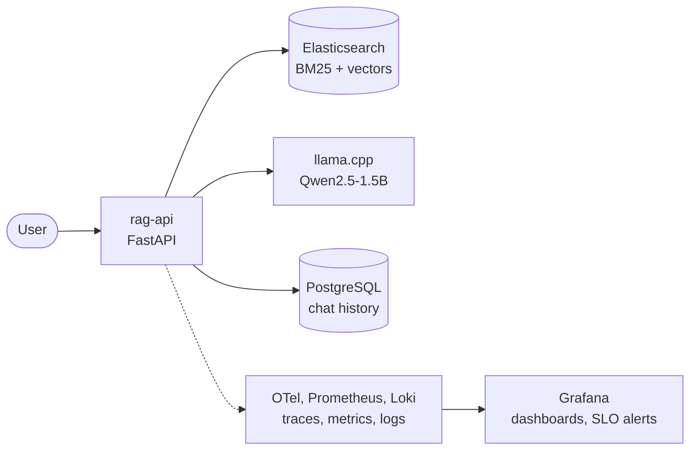
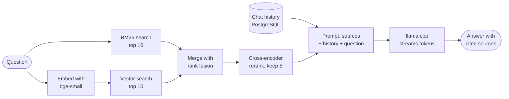
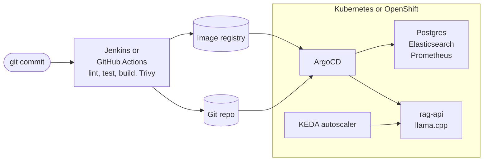
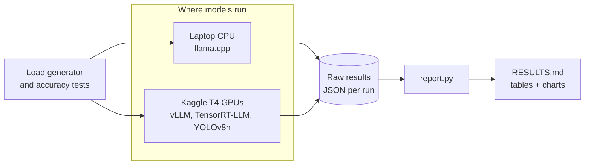

# industrial-llm-platform

Open-source platform for serving, benchmarking and operating small LLMs: llama.cpp on CPU and vLLM on free Kaggle T4s,
a cited RAG chat API, SLOs with burn-rate alerts, and a kind cluster deployed by ArgoCD and Jenkins. Free tools only.

> **Development stack, not hardened.** No login on the chat API, plain-HTTP Elasticsearch, placeholder passwords.
> Read [SECURITY.md](SECURITY.md) before exposing anything beyond your machine.

## Prerequisites

| Need | Detail |
|------|--------|
| Docker with Compose v2 | Docker Desktop on Windows or macOS, Docker Engine on Linux |
| Memory for Docker | 8 GB or more (the running stack used about 3.7 GiB) |
| Free disk | about 15 GB (images about 11 GB, model 1.1 GB, corpus and index) |
| Internet on first start | images, the GGUF model from Hugging Face, the corpus PDFs |
| Free local ports | 8000, 8080, 5432, 9200, 9090, 3000, 3100, 3200, 4317, 4318, 8888, 12345 (all bound to 127.0.0.1) |
| Shell | bash; on Windows use Git Bash |

Only for the optional parts: `kind` and `kubectl` (Kubernetes demo), OpenShift Local (OKD demo), a free Kaggle
account with a verified phone (GPU benchmarks), `uv` (tests and benchmark scripts).

## Results

Every number below is copied from the linked file, which links on to the raw output. Nothing here was run by hand
outside those files.
The public repo is a one-commit snapshot of the development history, so commit ids named in evidence files and
`run.json` (`git_commit`) refer to that history and cannot be opened here. The files they describe are all included.

**vLLM 0.31.0 on Kaggle T4** (Qwen2.5, 3 repeats per cell, mean, 2026-10-09). Source: [benchmark/RESULTS.md](benchmark/RESULTS.md), GPU table.

| Cell | Concurrency | Output tok/s | TTFT p50 s | E2E p95 s |
|------|-------------|--------------|------------|-----------|
| 1.5B FP16, 1x T4 | 1 | 51.6 | 0.034 | 2.646 |
| 1.5B AWQ INT4, 1x T4 | 1 | 115.2 | 0.030 | 1.361 |
| 1.5B FP16, 1x T4 | 8 | 356.0 | 0.302 | 3.731 |
| 1.5B AWQ INT4, 1x T4 | 8 | 567.1 | 0.286 | 2.686 |
| 1.5B FP16, 1x T4 | 32 | 716.3 | 1.171 | 6.077 |
| 1.5B AWQ INT4, 1x T4 | 32 | 907.6 | 1.197 | 4.868 |
| 7B AWQ INT4, 1x T4 | 8 | 181.9 | 0.970 | 8.349 |
| 1.5B FP16, TP=2 on 2x T4 | 32 | 1121.0 | 0.761 | 3.832 |

**llama.cpp b11459 on a laptop CPU** (Qwen2.5-1.5B GGUF Q4_K_M, 4 threads, 2 slots, session cpu-20261009, 3 repeats per
row). Source: [benchmark/RESULTS.md](benchmark/RESULTS.md), CPU tables.

| Prompt cache | Concurrency | Output tok/s | TTFT p50 s | TTFT p95 s |
|--------------|-------------|--------------|------------|------------|
| warm (96% of prompt tokens cached) | 1 | 24.2 | 0.210 | 0.307 |
| warm | 4 | 31.0 | 8.584 | 9.181 |
| warm | 8 | 29.8 | 25.8 | 27.1 |
| cold (server restarted before each repeat) | 1 | 17.2 | 0.241 | 9.333 |
| cold | 4 | 19.9 | 18.0 | 29.3 |
| cold | 8 | 20.1 | 38.2 | 66.3 |

**Accuracy, GSM8K** (first 250 test items, lm-evaluation-harness 0.4.13). AWQ minus FP16, paired over the same items:
strict-match -0.060, 95% CI [-0.128, +0.008]; flexible-extract -0.064, 95% CI [-0.128, +0.000]. AWQ scores about 6
points lower, but 250 items do not separate that from zero (flexible-extract only just). Sources: [benchmark/RESULTS.md](benchmark/RESULTS.md), Accuracy section;
[phase2-gpu.txt](docs/evidence/phase2-gpu.txt).

**RAG** (9 public domain NASA and NIST documents, 30 labelled questions, run 20261008T113955Z). Sources:
[summary.md](rag/eval/results/20261008T113955Z/summary.md), [judge summary.md](rag/eval/results/20261008T113955Z/judge-20261008T120952Z/summary.md).

| Metric | Value | n |
|--------|-------|---|
| recall@5 (gold doc and page, or the page before, in top 5) | 0.867 | 30 |
| doc recall@5 | 1.000 | 30 |
| faithfulness (local 7B judge) | 0.592 | 12 |
| answer relevancy (local 7B judge) | 0.798 | 12 |

**Autoscaling** (a demo, not a benchmark: 60 requests at concurrency 6 through the kind ingress). KEDA scaled
llama.cpp from 1 to 3 replicas and back, twice. Sources: [phase5a-platform.txt](docs/evidence/phase5a-platform.txt)
section 6, [clean-run2-keda.log](docs/evidence/phase5a-review/clean-run2-keda.log).

| Run | Load start | Scale up | Load end | Back to 1 |
|-----|------------|----------|----------|-----------|
| 1 | 06:05:04Z | size 3 at 06:05:06Z (2 s) | 06:11:28Z | 06:12:22Z (54 s after) |
| 2 | 07:04:20Z | size 2 at 07:04:38Z, size 3 at 07:05:38Z (78 s) | 07:11:34Z | 07:12:25Z (51 s after) |

**SLOs** (targets, not measured attainment): RAG availability 99% of valid `/chat` requests, and 95% of chats get
the first token within 60 s, both over 30 days. Source: [observability/SLOs.md](observability/SLOs.md).

**Logs and LLM traces:** Loki (every compose service, via Alloy) runs by default; self-hosted Langfuse is compose
profile `langfuse`, off by default (about 2.5 GiB RAM). [v3-loki-langfuse.txt](docs/evidence/v3-loki-langfuse.txt)

**TensorRT-LLM 0.14.0 vs vLLM 0.31.0, same Kaggle T4 session** (Qwen2.5-1.5B FP16, run v3i, 3 repeats per cell).
Source: [benchmark/RESULTS.md](benchmark/RESULTS.md), TensorRT-LLM vs vLLM table; [v3-trtllm.txt](docs/evidence/v3-trtllm.txt).

| Concurrency | TRT-LLM out tok/s | vLLM out tok/s | TRT-LLM / vLLM | TRT-LLM TTFT p50 s | vLLM TTFT p50 s |
|-------------|-------------------|----------------|----------------|--------------------|-----------------|
| 1 | 68.9 | 55.7 | 1.24 | 0.025 | 0.033 |
| 8 | 368.3 | 359.7 | 1.02 | 0.357 | 0.294 |
| 32 | 613.8 | 732.5 | 0.84 | 2.860 | 1.109 |

At c1 the vLLM cell ran at SM clock p50 642.5 MHz against 1040.0 MHz for TRT-LLM, both power-capped, so part of that
gap may be clock. GSM8K (250 items), TRT-LLM minus vLLM: strict-match +0.012, 95% CI [-0.012, +0.036]; flexible-extract
+0.000. TRT-LLM runs behind its own patched OpenAI example server, not Triton.

**Vision, YOLOv8n** (Ultralytics, AGPL-3.0). Source: [benchmark/RESULTS.md](benchmark/RESULTS.md), Vision sections.
Images/s at batch 1: laptop CPU ONNX Runtime 23.1, T4 ONNX Runtime CUDA FP32 162.3, T4 TensorRT FP16 295.1. mAP50-95 on
the first 500 COCO val2017 images: 0.401 for PyTorch FP32, ONNX FP32 and TensorRT FP16.

**Not run:** Red Hat OpenShift (OKD 4.22 via OpenShift Local was tested), Triton's native TensorRT and TensorRT-LLM
backends (they need Docker; vision was served through PyTriton's Python backend), Bitbucket. See
[docs/LIMITATIONS.md](docs/LIMITATIONS.md).

How to read these:
- Every benchmark request decodes a fixed 128 tokens with `ignore_eos`. The numbers describe a fixed-length decode,
  not where the model would stop.
- CPU and GPU rows are not like for like (hardware, weights, server, concurrency, cache regime). Compare within a table.
- vLLM runs with prefix caching off. llama.cpp keeps its prompt cache, so its rows are split into warm and cold.
- The run v2 FP16 c1 cell ran at about 56% of the SM clock of the other GPU cells (p50 575 MHz vs median 1030 MHz,
  cause not recorded; [benchmark/RESULTS.md](benchmark/RESULTS.md)). The AWQ vs FP16 gap at c1 carries that confound.
  Later sessions sampled clock event reasons: in run v3i the SW power cap was active in 91 to 100% of samples of
  every cell, both engines ([v3-trtllm.txt](docs/evidence/v3-trtllm.txt)).
- GSM8K ran with vLLM applying the model's `repetition_penalty` 1.1 to both precisions: the delta is like for like,
  the absolute scores are not stock settings.
- The judge is Qwen2.5-7B Q4_K_M on CPU, with no human calibration, and contradicted itself on 2 of 24 scores. At
  n = 12 one question moves a mean by about 0.08. Use the scores to compare runs of this pipeline, not as absolute quality.
- The 60 s TTFT threshold is a CPU development target set from 33 cold requests. See [docs/LIMITATIONS.md](docs/LIMITATIONS.md).

## Architecture

Four views of the same platform.

**1. The chat app and its monitoring** (runs on a laptop with `docker compose`):



**2. How one chat question is answered** (hybrid search, rerank, then a cited answer streamed back):



**3. How code reaches the cluster** (CI builds, ArgoCD deploys from git):



**4. How the benchmark numbers are made** (every number in Results comes from this path):



## Quickstart

One command brings up the whole laptop stack: model download, databases, chat API, corpus index and monitoring.

```bash
cp .env.example .env                    # dev placeholder passwords; change them for anything shared
docker compose up -d --wait             # returns when every service is healthy and the index is built
bash scripts/smoke.sh                   # PASS/FAIL per check

curl -N http://127.0.0.1:8000/chat -H 'Content-Type: application/json'   -d '{"message": "What coverage factor does NIST use for expanded uncertainty?"}'
# follow-up: add "session_id": "<id from the first event>"
# Chat page: http://127.0.0.1:8000/   Grafana: http://127.0.0.1:3000   Prometheus: http://127.0.0.1:9090
```

The chat page (`rag/app/static/index.html`, one file, no dependencies) streams the answer, turns `[n]` into buttons that
open the cited source, and restores the last session on reload. It is served by `rag-api` at `/`, so the kind and OKD
ingress would serve it too (not checked there).

The first start downloads the model, images and corpus, then indexes it (measured: about 66 min for the stack
cold and 19 min for the index on the dev laptop). Later starts skip both and take under a minute.
Re-index the demo documents with `docker compose run --rm -e INGEST_SKIP_IF_PRESENT=0 rag-ingest`. It replaces only
the demo documents, not ones you added.

### Sign-in (optional)

By default anyone who can reach the page can use it. To require a login (Keycloak plus oauth2-proxy, Compose only):

```bash
docker compose -f docker-compose.yml -f docker-compose.auth.yml up -d --wait
# open http://127.0.0.1:4180/ , sign in as admin-demo or user-demo (passwords in .env)
```

`admin-demo` (group `rag-admins`) can add and remove documents; `user-demo` can chat and read. Chats are private to
each person. The API checks the tokens itself and works with any OpenID Connect provider, so a company can use its own
instead of Keycloak. Details and what to harden first: [SECURITY.md](SECURITY.md).

### Use your own documents

The chat page has a **Documents** button. You can add PDF, TXT, MD and HTML files (drop them in or choose them) and
web page addresses, watch them being read and indexed, remove single documents, or **Start from scratch**. Answers
then cite your documents. To start with nothing at all instead of the demo documents:

```bash
echo DEMO_CORPUS=0 >> .env && docker compose up -d --wait   # empty library, no 19 minute demo index
```

Indexing runs on the CPU: a one-page text file takes seconds, a 2 MB PDF (359 passages) took 148 s on the
dev laptop with the rest of the stack idle. Only public web addresses are fetched unless you set `ALLOW_PRIVATE_URLS=1`.
`DOCS_WRITE=0` turns adding and removing off. See [SECURITY.md](SECURITY.md) before exposing the page.

Optional parts, each with its own command:

```bash
bash scripts/kind-up.sh                 # kind + registry + git daemon + KEDA + Traefik + ArgoCD, waits for Synced/Healthy
curl -N http://rag-api.localhost:8090/chat -H 'Content-Type: application/json' \
  -d '{"message": "What coverage factor does NIST use for expanded uncertainty?"}'
bash scripts/kind-down.sh

cp ci/jenkins/.env.example ci/jenkins/.env   # then: run the job as in ci/jenkins/README.md
docker compose -f ci/jenkins/docker-compose.yml --env-file ci/jenkins/.env up -d --build --wait
```

Ports and services: [docs/LAYOUT.md](docs/LAYOUT.md).

Tests and lint:

```bash
uv venv --python 3.12 benchmark/.venv && uv pip install --python benchmark/.venv -r benchmark/requirements.txt
benchmark/.venv/Scripts/python -m pytest benchmark/tests        # bin/ instead of Scripts/ on Linux
cd rag && TEST_PG_URL=postgresql+psycopg://postgres:<password>@127.0.0.1:5432 uv run --python 3.12 --frozen pytest; cd ..
MSYS_NO_PATHCONV=1 docker run --rm -v "$PWD/observability/prometheus:/etc/prometheus:ro" --entrypoint promtool prom/prometheus:v3.15.0 test rules /etc/prometheus/tests/slo_test.yml /etc/prometheus/tests/slo_windows_test.yml
uvx --python 3.12 pre-commit@4.6.2 run --all-files   # pre-commit only sees files git tracks
```

The CPU benchmark, `scripts/keda-demo.sh` and `benchmark/report.py` use `benchmark/.venv`.

## How to reproduce

Times are the measured ones from the evidence files on the dev machine (Windows 11 laptop, AMD Ryzen 7 7730U,
Docker Desktop WSL2).

| Result | Command | Hardware | Measured time | Evidence |
|--------|---------|----------|---------------|----------|
| Compose stack + smoke | `docker compose up -d --wait && bash scripts/smoke.sh` | laptop | 773 s with images cached, 3994 s cold | [phase1-smoke.txt](docs/evidence/phase1-smoke.txt) |
| CPU benchmark (3 cold + 3 warm per concurrency) | driver script in the evidence file, calling `benchmark/loadgen/run.py`; then `benchmark/report.py` | laptop, other services stopped | 2 h 22 min 31 s | [phase2-cpu-rerun.txt](docs/evidence/phase2-cpu-rerun.txt) |
| GPU benchmark + GSM8K | `notebooks/build_notebook.py`, `kaggle kernels push -p notebooks -t 14400`, download, `benchmark/report.py` ([inference/README.md](inference/README.md)) | Kaggle 2x T4 (free tier) | 39 min 17 s session | [phase2-gpu.txt](docs/evidence/phase2-gpu.txt) |
| RAG ingest | `docker compose run --rm -e INGEST_SKIP_IF_PRESENT=0 rag-ingest` (first `up` runs it automatically) | laptop | 1115 s (9 documents, 3129 chunks) | [phase3-rag.txt](docs/evidence/phase3-rag.txt) |
| RAG eval + judge | `rag/eval/run_eval.py`, `rag/eval/judge_run.py` ([rag/eval/README.md](rag/eval/README.md)) | laptop, 7B judge on CPU | 11:39:55 to 12:03:16 (run), 12:09:52 to 13:07:15 (12-id judge) | [phase3-rag.txt](docs/evidence/phase3-rag.txt) |
| SLO rule tests | promtool command under Quickstart ([observability/SLOs.md](observability/SLOs.md)) | laptop | 83 s (whole promtool block) | [phase4-observability.txt](docs/evidence/phase4-observability.txt) |
| GPU replay dashboard | `observability/gpu-replay/backfill.sh` | laptop | not recorded | [phase4-observability.txt](docs/evidence/phase4-observability.txt) |
| kind cluster | `bash scripts/kind-up.sh` | laptop | after the network fixes: one clean run, 28m46s, with all images already on the host; re-run 60 s. Before them: clean runs of 34m25s to 46m28s, and 4 clean attempts that failed. A slow first pull after the fixes is untested ([LIMITATIONS](docs/LIMITATIONS.md)) | [deploy/README.md](deploy/README.md), [phase5b-ci.txt](docs/evidence/phase5b-ci.txt) |
| KEDA 1 to 3 to 1 | `bash scripts/keda-demo.sh 6 60` | laptop, kind | 06:05:03Z to 06:12:39Z (run 1) | [phase5a-platform.txt](docs/evidence/phase5a-platform.txt) |
| Jenkins pipeline | see [ci/jenkins/README.md](ci/jenkins/README.md) | laptop, needs kind-up first | controller up 3m36s; builds #1 2471 s, #2 2452 s, #3 220 s (all layers cached) | [phase5b-ci.txt](docs/evidence/phase5b-ci.txt) |

GPU runs use the free Kaggle quota. Each push is a GPU session that needs the owner's approval first
([docs/PLAN.md](docs/PLAN.md), "Approvals"). The notebook embeds the benchmark code, so no Kaggle dataset or git remote is needed.

## Further reading

- [benchmark/RESULTS.md](benchmark/RESULTS.md): full tables, per-repeat rows, flags, raw file links.
- [inference/README.md](inference/README.md): serving paths and why vLLM 0.31.0 +cu129 on T4.
- [rag/eval/README.md](rag/eval/README.md): question set, metrics, judge limitations. Corpus licences: [rag/data/SOURCES.md](rag/data/SOURCES.md).
- [observability/SLOs.md](observability/SLOs.md): SLI definitions, thresholds, burn-rate alerts, tests.
- [deploy/README.md](deploy/README.md): charts, kind vs OpenShift, how ArgoCD reads the repo without a remote.
- [ci/jenkins/README.md](ci/jenkins/README.md): Jenkins setup and stages.
- [docs/LAYOUT.md](docs/LAYOUT.md): repository layout, compose services and ports.
- [docs/DECISIONS.md](docs/DECISIONS.md), [docs/LIMITATIONS.md](docs/LIMITATIONS.md), [docs/VERSIONS.md](docs/VERSIONS.md), [docs/STATUS.md](docs/STATUS.md).

## License

Apache-2.0, see [LICENSE](LICENSE) and [NOTICE](NOTICE). Models, datasets and some pulled images keep their own
licences, listed in [THIRD_PARTY_NOTICES.md](THIRD_PARTY_NOTICES.md). The optional vision path depends on AGPL-3.0
Ultralytics.
