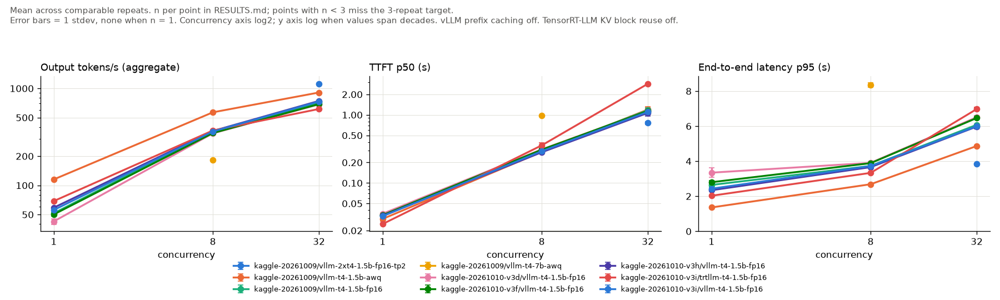
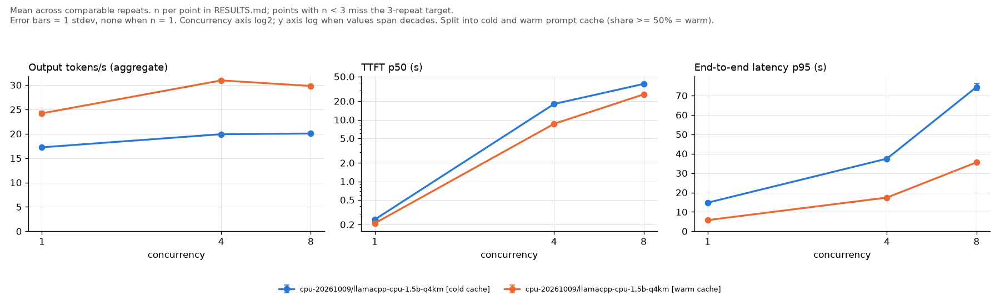

# Benchmark results

Generated by `python benchmark/report.py` from `benchmark/results/raw/`. Do not edit by hand.

Smoke runs (`results/raw/smoke/`) are excluded. Every number below links to its raw file.

Every request decodes a fixed number of tokens (`max_tokens` in each raw config, default 128) with `ignore_eos`, so throughput and latency describe a fixed-length decode, not the model's natural stopping point.

## Latency and throughput

Values are mean ± stdev across the repeats in each row (n = repeats column); each repeat's percentile is computed over its measured requests (warmup excluded).

### GPU (vLLM, TensorRT-LLM)

Prefix caching is off (`--no-enable-prefix-caching`), so every repeat runs prefill and cells are not split by cache regime. GPU mem max mostly reflects vLLM pre-allocating `--gpu-memory-utilization 0.90` of each card for weights and KV cache, not the memory the workload needed. GPU columns are over all sampled GPUs (both cards for TP=2), from nvidia-smi every 500 ms during the measured window.

| cell | hardware | engine | precision | conc | repeats | out tok/s | req/s | TTFT p50 s | TTFT p95 s | ITL p50 ms | TPOT p50 ms | E2E p50 s | E2E p95 s | E2E p99 s | tok/s per req p50 | err rate | GPU mem max MiB | GPU util mean % | SM clock p50 MHz | GPU temp max C |
|---|---|---|---|---|---|---|---|---|---|---|---|---|---|---|---|---|---|---|---|---|
| kaggle-20261009/vllm-2xt4-1.5b-fp16-tp2 | 2x Tesla T4 (Kaggle) | vllm 0.31.0 | fp16 | 32 | 3 | 1121.0 ± 7.1 | 8.758 ± 0.055 | 0.761 ± 0.037 | 1.284 ± 0.023 | 18.9 ± 0.1 | 22.5 ± 0.3 | 3.662 ± 0.003 | 3.832 ± 0.040 | 3.846 ± 0.039 | 35.0 ± 0.0 | 0.000 ± 0.000 | 13731.0 ± 0.0 | 99.6 ± 0.6 | 1345.0 ± 15.6 | 80.7 ± 1.5 |
| kaggle-20261009/vllm-t4-1.5b-awq | 1x Tesla T4 (Kaggle) | vllm 0.31.0 | awq-int4 | 1 | 3 | 115.2 ± 0.6 | 0.900 ± 0.005 | 0.030 ± 0.002 | 0.257 ± 0.001 | 8.017 ± 0.040 | 7.928 ± 0.076 | 1.037 ± 0.011 | 1.361 ± 0.016 | 1.372 ± 0.023 | 123.5 ± 1.3 | 0.000 ± 0.000 | 13295.0 ± 0.0 | 98.4 ± 0.4 | 1045.0 ± 8.7 | 79.0 ± 2.6 |
| kaggle-20261009/vllm-t4-1.5b-awq | 1x Tesla T4 (Kaggle) | vllm 0.31.0 | awq-int4 | 8 | 3 | 567.1 ± 2.3 | 4.430 ± 0.018 | 0.286 ± 0.007 | 0.852 ± 0.105 | 9.844 ± 0.057 | 10.8 ± 0.3 | 1.745 ± 0.059 | 2.686 ± 0.018 | 2.700 ± 0.009 | 73.5 ± 2.7 | 0.000 ± 0.000 | 13401.0 ± 0.0 | 99.3 ± 0.1 | 1250.0 ± 8.7 | 77.7 ± 0.6 |
| kaggle-20261009/vllm-t4-1.5b-awq | 1x Tesla T4 (Kaggle) | vllm 0.31.0 | awq-int4 | 32 | 3 | 907.6 ± 2.6 | 7.091 ± 0.020 | 1.197 ± 0.128 | 2.187 ± 0.107 | 19.6 ± 0.1 | 25.2 ± 0.5 | 4.517 ± 0.017 | 4.868 ± 0.021 | 5.015 ± 0.100 | 28.3 ± 0.1 | 0.000 ± 0.000 | 13401.0 ± 0.0 | 100.0 ± 0.1 | 1230.0 ± 15.0 | 77.0 ± 0.0 |
| kaggle-20261009/vllm-t4-1.5b-fp16 | 1x Tesla T4 (Kaggle) | vllm 0.31.0 | fp16 | 1 | 3 | 51.6 ± 1.9 | 0.403 ± 0.015 | 0.034 ± 0.001 | 0.262 ± 0.004 | 19.2 ± 0.9 | 19.3 ± 0.7 | 2.499 ± 0.082 | 2.646 ± 0.133 | 2.673 ± 0.156 | 51.2 ± 1.7 | 0.000 ± 0.000 | 13209.0 ± 0.0 | 99.4 ± 0.2 | 575.0 ± 34.6 | 79.0 ± 1.7 |
| kaggle-20261009/vllm-t4-1.5b-fp16 | 1x Tesla T4 (Kaggle) | vllm 0.31.0 | fp16 | 8 | 3 | 356.0 ± 0.9 | 2.781 ± 0.007 | 0.302 ± 0.010 | 0.691 ± 0.116 | 18.3 ± 0.1 | 19.1 ± 0.1 | 2.830 ± 0.009 | 3.731 ± 0.035 | 3.752 ± 0.031 | 45.2 ± 0.1 | 0.000 ± 0.000 | 13315.0 ± 0.0 | 99.9 ± 0.0 | 1070.0 ± 17.3 | 77.3 ± 0.6 |
| kaggle-20261009/vllm-t4-1.5b-fp16 | 1x Tesla T4 (Kaggle) | vllm 0.31.0 | fp16 | 32 | 3 | 716.3 ± 1.1 | 5.596 ± 0.009 | 1.171 ± 0.099 | 2.198 ± 0.096 | 29.5 ± 0.1 | 35.6 ± 1.0 | 5.675 ± 0.037 | 6.077 ± 0.013 | 6.225 ± 0.245 | 22.6 ± 0.1 | 0.000 ± 0.000 | 13315.0 ± 0.0 | 99.9 ± 0.1 | 1080.0 ± 0.0 | 77.7 ± 0.6 |
| kaggle-20261009/vllm-t4-7b-awq | 1x Tesla T4 (Kaggle) | vllm 0.31.0 | awq-int4 | 8 | 3 | 181.9 ± 0.3 | 1.421 ± 0.003 | 0.970 ± 0.009 | 2.887 ± 0.645 | 29.9 ± 0.0 | 31.4 ± 0.6 | 5.523 ± 0.004 | 8.349 ± 0.140 | 8.393 ± 0.121 | 23.2 ± 0.0 | 0.000 ± 0.000 | 12927.0 ± 0.0 | 99.9 ± 0.1 | 1010.0 ± 8.7 | 78.7 ± 1.2 |
| kaggle-20261010-v3d/vllm-t4-1.5b-fp16 | 1x Tesla T4 (Kaggle) | vllm 0.31.0 | fp16 | 1 | 3 | 42.5 ± 2.8 | 0.332 ± 0.022 | 0.035 ± 0.001 | 0.279 ± 0.003 | 23.6 ± 1.3 | 23.6 ± 1.2 | 3.074 ± 0.095 | 3.347 ± 0.266 | 3.502 ± 0.507 | 41.7 ± 1.3 | 0.000 ± 0.000 | 13209.0 ± 0.0 | 99.7 ± 0.1 | 450.0 ± 26.0 | 78.7 ± 2.1 |
| kaggle-20261010-v3d/vllm-t4-1.5b-fp16 | 1x Tesla T4 (Kaggle) | vllm 0.31.0 | fp16 | 8 | 3 | 344.1 ± 1.8 | 2.688 ± 0.014 | 0.312 ± 0.009 | 0.842 ± 0.006 | 18.8 ± 0.1 | 19.9 ± 0.3 | 2.922 ± 0.019 | 3.908 ± 0.007 | 3.923 ± 0.009 | 43.8 ± 0.3 | 0.000 ± 0.000 | 13315.0 ± 0.0 | 99.9 ± 0.0 | 970.0 ± 8.7 | 77.3 ± 0.6 |
| kaggle-20261010-v3d/vllm-t4-1.5b-fp16 | 1x Tesla T4 (Kaggle) | vllm 0.31.0 | fp16 | 32 | 3 | 684.5 ± 1.3 | 5.348 ± 0.010 | 1.142 ± 0.051 | 2.231 ± 0.011 | 30.3 ± 0.1 | 37.2 ± 0.5 | 5.915 ± 0.015 | 6.511 ± 0.084 | 6.845 ± 0.013 | 21.6 ± 0.1 | 0.000 ± 0.000 | 13315.0 ± 0.0 | 99.9 ± 0.2 | 1005.0 ± 0.0 | 77.0 ± 0.0 |
| kaggle-20261010-v3f/vllm-t4-1.5b-fp16 | 1x Tesla T4 (Kaggle) | vllm 0.31.0 | fp16 | 1 | 3 | 50.2 ± 2.1 | 0.392 ± 0.017 | 0.034 ± 0.000 | 0.274 ± 0.001 | 19.6 ± 0.8 | 19.6 ± 0.8 | 2.574 ± 0.023 | 2.802 ± 0.088 | 2.839 ± 0.104 | 49.7 ± 0.4 | 0.000 ± 0.000 | 13209.0 ± 0.0 | 99.6 ± 0.1 | 565.0 ± 43.3 | 78.7 ± 1.2 |
| kaggle-20261010-v3f/vllm-t4-1.5b-fp16 | 1x Tesla T4 (Kaggle) | vllm 0.31.0 | fp16 | 8 | 3 | 346.5 ± 1.2 | 2.707 ± 0.010 | 0.308 ± 0.006 | 0.769 ± 0.120 | 18.7 ± 0.0 | 19.7 ± 0.3 | 2.902 ± 0.012 | 3.889 ± 0.018 | 3.907 ± 0.018 | 44.1 ± 0.2 | 0.000 ± 0.000 | 13315.0 ± 0.0 | 99.9 ± 0.2 | 990.0 ± 0.0 | 77.3 ± 0.6 |
| kaggle-20261010-v3f/vllm-t4-1.5b-fp16 | 1x Tesla T4 (Kaggle) | vllm 0.31.0 | fp16 | 32 | 3 | 689.6 ± 1.1 | 5.387 ± 0.009 | 1.145 ± 0.045 | 2.228 ± 0.018 | 30.0 ± 0.1 | 36.4 ± 1.0 | 5.892 ± 0.043 | 6.467 ± 0.095 | 6.787 ± 0.018 | 21.7 ± 0.2 | 0.000 ± 0.000 | 13315.0 ± 0.0 | 100.0 ± 0.0 | 1020.0 ± 0.0 | 77.0 ± 0.0 |
| kaggle-20261010-v3h/vllm-t4-1.5b-fp16 | 1x Tesla T4 (Kaggle) | vllm 0.31.0 | fp16 | 1 | 3 | 58.9 ± 0.3 | 0.460 ± 0.003 | 0.033 ± 0.000 | 0.252 ± 0.001 | 16.4 ± 0.2 | 16.3 ± 0.2 | 2.160 ± 0.007 | 2.344 ± 0.057 | 2.354 ± 0.068 | 59.3 ± 0.2 | 0.000 ± 0.000 | 13209.0 ± 0.0 | 99.3 ± 0.1 | 715.0 ± 17.3 | 79.0 ± 1.7 |
| kaggle-20261010-v3h/vllm-t4-1.5b-fp16 | 1x Tesla T4 (Kaggle) | vllm 0.31.0 | fp16 | 8 | 3 | 363.9 ± 0.5 | 2.843 ± 0.004 | 0.283 ± 0.005 | 0.683 ± 0.116 | 18.0 ± 0.0 | 19.1 ± 0.2 | 2.775 ± 0.007 | 3.662 ± 0.028 | 3.680 ± 0.028 | 46.1 ± 0.1 | 0.000 ± 0.000 | 13315.0 ± 0.0 | 99.9 ± 0.0 | 1125.0 ± 0.0 | 77.3 ± 0.6 |
| kaggle-20261010-v3h/vllm-t4-1.5b-fp16 | 1x Tesla T4 (Kaggle) | vllm 0.31.0 | fp16 | 32 | 3 | 743.3 ± 1.4 | 5.807 ± 0.011 | 1.070 ± 0.114 | 2.135 ± 0.017 | 28.5 ± 0.0 | 33.8 ± 0.9 | 5.516 ± 0.032 | 5.978 ± 0.136 | 6.002 ± 0.107 | 23.2 ± 0.1 | 0.000 ± 0.000 | 13315.0 ± 0.0 | 100.0 ± 0.0 | 1145.0 ± 8.7 | 77.7 ± 0.6 |
| kaggle-20261010-v3i/trtllm-t4-1.5b-fp16 | 1x Tesla T4 (Kaggle) | trtllm 0.14.0 | fp16 | 1 | 3 | 68.9 ± 0.2 | 0.538 ± 0.002 | 0.025 ± 0.000 | 0.184 ± 0.001 | 14.1 ± 0.0 | 14.1 ± 0.0 | 1.811 ± 0.002 | 2.029 ± 0.001 | 2.039 ± 0.013 | 70.7 ± 0.1 | 0.000 ± 0.000 | 14085.0 ± 0.0 | 97.7 ± 0.1 | 1040.0 ± 8.7 | 79.0 ± 1.7 |
| kaggle-20261010-v3i/trtllm-t4-1.5b-fp16 | 1x Tesla T4 (Kaggle) | trtllm 0.14.0 | fp16 | 8 | 3 | 368.3 ± 2.5 | 2.877 ± 0.020 | 0.357 ± 0.034 | 0.769 ± 0.255 | 17.4 ± 0.0 | 18.5 ± 0.4 | 2.737 ± 0.036 | 3.334 ± 0.040 | 3.340 ± 0.040 | 46.8 ± 0.6 | 0.000 ± 0.000 | 14085.0 ± 0.0 | 98.4 ± 0.1 | 972.5 ± 4.3 | 77.3 ± 0.6 |
| kaggle-20261010-v3i/trtllm-t4-1.5b-fp16 | 1x Tesla T4 (Kaggle) | trtllm 0.14.0 | fp16 | 32 | 3 | 613.8 ± 7.5 | 4.795 ± 0.059 | 2.860 ± 0.045 | 3.052 ± 0.045 | 25.1 ± 0.0 | 29.0 ± 0.7 | 6.622 ± 0.083 | 6.978 ± 0.100 | 6.988 ± 0.101 | 19.3 ± 0.2 | 0.000 ± 0.000 | 14085.0 ± 0.0 | 90.4 ± 2.3 | 850.0 ± 17.3 | 77.7 ± 0.6 |
| kaggle-20261010-v3i/vllm-t4-1.5b-fp16 | 1x Tesla T4 (Kaggle) | vllm 0.31.0 | fp16 | 1 | 3 | 55.7 ± 1.3 | 0.435 ± 0.010 | 0.033 ± 0.000 | 0.256 ± 0.003 | 17.5 ± 0.6 | 17.6 ± 0.6 | 2.300 ± 0.045 | 2.433 ± 0.107 | 2.446 ± 0.114 | 55.7 ± 1.1 | 0.000 ± 0.000 | 13209.0 ± 0.0 | 99.6 ± 0.1 | 642.5 ± 35.4 | 78.7 ± 2.1 |
| kaggle-20261010-v3i/vllm-t4-1.5b-fp16 | 1x Tesla T4 (Kaggle) | vllm 0.31.0 | fp16 | 8 | 3 | 359.7 ± 0.3 | 2.810 ± 0.002 | 0.294 ± 0.011 | 0.626 ± 0.116 | 18.1 ± 0.1 | 18.7 ± 0.1 | 2.806 ± 0.004 | 3.722 ± 0.034 | 3.739 ± 0.032 | 45.6 ± 0.1 | 0.000 ± 0.000 | 13315.0 ± 0.0 | 99.8 ± 0.1 | 1090.0 ± 8.7 | 77.3 ± 0.6 |
| kaggle-20261010-v3i/vllm-t4-1.5b-fp16 | 1x Tesla T4 (Kaggle) | vllm 0.31.0 | fp16 | 32 | 3 | 732.5 ± 1.8 | 5.723 ± 0.014 | 1.109 ± 0.112 | 2.029 ± 0.016 | 28.8 ± 0.1 | 34.6 ± 0.8 | 5.544 ± 0.063 | 5.998 ± 0.112 | 6.319 ± 0.119 | 23.1 ± 0.3 | 0.000 ± 0.000 | 13315.0 ± 0.0 | 100.0 ± 0.0 | 1105.0 ± 8.7 | 77.3 ± 0.6 |

TensorRT-LLM rows: KV cache block reuse (its prefix caching) is off, and its KV cache takes 0.90 of the GPU memory left free after loading the engine, where vLLM's 0.90 is of the whole card. Server and engine build commands: server_args in each raw file and the session's server_args/ directory.

kaggle-20261010-v3i, TensorRT-LLM vs vLLM: prompts sha256 72fb01ab9477 vs 72fb01ab9477; max_tokens [128] vs [128]; ignore_eos [True] vs [True]; concurrency [1, 8, 32] vs [1, 8, 32]; requests whose output tokens differ from max_tokens: 0 vs 0; truncated streams: 0 vs 0.

| session | conc | TRT-LLM out tok/s | vLLM out tok/s | TRT-LLM / vLLM | TRT-LLM TTFT p50 s | vLLM TTFT p50 s | TRT-LLM E2E p95 s | vLLM E2E p95 s | TRT-LLM SM clock p50 MHz | vLLM SM clock p50 MHz |
|---|---|---|---|---|---|---|---|---|---|---|
| kaggle-20261010-v3i | 1 | 68.9 ± 0.2 | 55.7 ± 1.3 | 1.24 | 0.025 ± 0.000 | 0.033 ± 0.000 | 2.029 ± 0.001 | 2.433 ± 0.107 | 1040.0 ± 8.7 | 642.5 ± 35.4 |
| kaggle-20261010-v3i | 8 | 368.3 ± 2.5 | 359.7 ± 0.3 | 1.02 | 0.357 ± 0.034 | 0.294 ± 0.011 | 3.334 ± 0.040 | 3.722 ± 0.034 | 972.5 ± 4.3 | 1090.0 ± 8.7 |
| kaggle-20261010-v3i | 32 | 613.8 ± 7.5 | 732.5 ± 1.8 | 0.84 | 2.860 ± 0.045 | 1.109 ± 0.112 | 6.978 ± 0.100 | 5.998 ± 0.112 | 850.0 ± 17.3 | 1105.0 ± 8.7 |

Both engines ran under the T4's 70 W power cap (clock event reasons per run in Raw files and flags); where the SM clock columns differ, part of the gap may be clock, not engine.

kaggle-20261009/vllm-t4-1.5b-fp16 c1 ran at about 56% of the SM clock of the other GPU cells (p50 575 MHz vs median 1030 MHz; cause not recorded). Read comparisons with this cell with that confound in mind.

kaggle-20261010-v3d/vllm-t4-1.5b-fp16 c1 ran at about 44% of the SM clock of the other GPU cells (p50 450 MHz vs median 1030 MHz; SW power cap active in 100% of samples). Read comparisons with this cell with that confound in mind.

kaggle-20261010-v3f/vllm-t4-1.5b-fp16 c1 ran at about 55% of the SM clock of the other GPU cells (p50 565 MHz vs median 1030 MHz; SW power cap active in 100% of samples). Read comparisons with this cell with that confound in mind.

Session differences: kaggle-20261009: Server args of vllm-t4-1.5b-fp16 vs kaggle-20261010-v3d, kaggle-20261010-v3f, kaggle-20261010-v3h, kaggle-20261010-v3i: lacks --generation-config vllm. kaggle-20261010-v3d: Server args of vllm-t4-1.5b-fp16 vs kaggle-20261009: adds --generation-config vllm. Same-session vLLM controls for TensorRT-LLM; TensorRT-LLM rows: not produced: FAILED-install.txt. kaggle-20261010-v3f: Server args of vllm-t4-1.5b-fp16 vs kaggle-20261009: adds --generation-config vllm. Same-session vLLM controls for TensorRT-LLM; TensorRT-LLM rows: not produced: FAILED-build-engine.txt. kaggle-20261010-v3h: Server args of vllm-t4-1.5b-fp16 vs kaggle-20261009: adds --generation-config vllm. Same-session vLLM controls for TensorRT-LLM; TensorRT-LLM rows: not produced: FAILED-build-engine.txt. kaggle-20261010-v3i: Server args of vllm-t4-1.5b-fp16 vs kaggle-20261009: adds --generation-config vllm. Same-session vLLM controls for TensorRT-LLM; TensorRT-LLM rows: present. Why it matters: without --generation-config vllm, vLLM applies the model's generation_config.json sampling defaults (Qwen2.5-1.5B: repetition_penalty 1.1, per the kaggle-20261009 server logs).

### CPU (llama.cpp)

| cell | hardware | engine | precision | conc | repeats | out tok/s | req/s | TTFT p50 s | TTFT p95 s | ITL p50 ms | TPOT p50 ms | E2E p50 s | E2E p95 s | E2E p99 s | tok/s per req p50 | err rate |
|---|---|---|---|---|---|---|---|---|---|---|---|---|---|---|---|---|
| cpu-20261009/llamacpp-cpu-1.5b-q4km [warm cache] | Windows 11 host, Docker Desktop WSL2, llama.cpp --threads 4 --parallel 2 | llama.cpp b11459 | gguf-q4_k_m | 1 | 3 | 24.2 ± 0.4 | 0.189 ± 0.003 | 0.210 ± 0.008 | 0.307 ± 0.018 | 39.2 ± 0.4 | 39.0 ± 0.6 | 5.181 ± 0.078 | 5.782 ± 0.272 | 6.163 ± 0.417 | 24.7 ± 0.4 | 0.000 ± 0.000 |
| cpu-20261009/llamacpp-cpu-1.5b-q4km [warm cache] | Windows 11 host, Docker Desktop WSL2, llama.cpp --threads 4 --parallel 2 | llama.cpp b11459 | gguf-q4_k_m | 4 | 3 | 31.0 ± 0.1 | 0.242 ± 0.001 | 8.584 ± 0.091 | 9.181 ± 0.019 | 60.9 ± 0.4 | 62.1 ± 1.0 | 16.5 ± 0.1 | 17.4 ± 0.1 | 17.5 ± 0.1 | 7.770 ± 0.045 | 0.000 ± 0.000 |
| cpu-20261009/llamacpp-cpu-1.5b-q4km [warm cache] | Windows 11 host, Docker Desktop WSL2, llama.cpp --threads 4 --parallel 2 | llama.cpp b11459 | gguf-q4_k_m | 8 | 3 | 29.8 ± 0.2 | 0.233 ± 0.002 | 25.8 ± 0.2 | 27.1 ± 0.5 | 63.3 ± 0.5 | 65.3 ± 0.6 | 34.1 ± 0.3 | 35.6 ± 0.4 | 36.0 ± 0.5 | 3.753 ± 0.028 | 0.000 ± 0.000 |

Cold prompt cache (llama.cpp repeats with cache share below 50%, e.g. the first repeat after a server restart):

| cell | hardware | engine | precision | conc | repeats | out tok/s | req/s | TTFT p50 s | TTFT p95 s | ITL p50 ms | TPOT p50 ms | E2E p50 s | E2E p95 s | E2E p99 s | tok/s per req p50 | err rate |
|---|---|---|---|---|---|---|---|---|---|---|---|---|---|---|---|---|
| cpu-20261009/llamacpp-cpu-1.5b-q4km [cold cache] | Windows 11 host, Docker Desktop WSL2, llama.cpp --threads 4 --parallel 2 | llama.cpp b11459 | gguf-q4_k_m | 1 | 3 | 17.2 ± 0.1 | 0.135 ± 0.001 | 0.241 ± 0.013 | 9.333 ± 0.056 | 38.2 ± 0.3 | 38.0 ± 0.4 | 5.069 ± 0.062 | 14.8 ± 0.1 | 15.0 ± 0.1 | 25.3 ± 0.3 | 0.000 ± 0.000 |
| cpu-20261009/llamacpp-cpu-1.5b-q4km [cold cache] | Windows 11 host, Docker Desktop WSL2, llama.cpp --threads 4 --parallel 2 | llama.cpp b11459 | gguf-q4_k_m | 4 | 3 | 19.9 ± 0.1 | 0.156 ± 0.001 | 18.0 ± 0.2 | 29.3 ± 0.3 | 61.2 ± 0.2 | 62.8 ± 0.5 | 26.0 ± 0.2 | 37.5 ± 0.3 | 46.5 ± 0.7 | 4.914 ± 0.037 | 0.000 ± 0.000 |
| cpu-20261009/llamacpp-cpu-1.5b-q4km [cold cache] | Windows 11 host, Docker Desktop WSL2, llama.cpp --threads 4 --parallel 2 | llama.cpp b11459 | gguf-q4_k_m | 8 | 3 | 20.1 ± 0.1 | 0.157 ± 0.001 | 38.2 ± 0.8 | 66.3 ± 1.7 | 63.9 ± 0.5 | 66.2 ± 0.6 | 46.7 ± 0.9 | 74.4 ± 2.0 | 84.5 ± 2.6 | 2.739 ± 0.054 | 0.000 ± 0.000 |

Earlier session, superseded (kept for the record, not in the charts): llamacpp-cpu-1.5b-q4km replaced by cpu-20261009/llamacpp-cpu-1.5b-q4km. Its regime cells have fewer than 3 comparable repeats.

| cell | hardware | engine | precision | conc | repeats | out tok/s | req/s | TTFT p50 s | TTFT p95 s | ITL p50 ms | TPOT p50 ms | E2E p50 s | E2E p95 s | E2E p99 s | tok/s per req p50 | err rate |
|---|---|---|---|---|---|---|---|---|---|---|---|---|---|---|---|---|
| llamacpp-cpu-1.5b-q4km (2026-10-08, superseded) [cold cache] | Windows 11 host, Docker Desktop WSL2, llama.cpp --threads 4 --parallel 2 | llama.cpp b11459 | gguf-q4_k_m | 1 | 1 | 15.5 | 0.121 | 0.299 | 10.8 | 41.4 | 42.3 | 5.696 | 16.8 | 17.3 | 22.5 | 0.000 |
| llamacpp-cpu-1.5b-q4km (2026-10-08, superseded) [cold cache] | Windows 11 host, Docker Desktop WSL2, llama.cpp --threads 4 --parallel 2 | llama.cpp b11459 | gguf-q4_k_m | 4 | 1 | 16.7 | 0.131 | 18.9 | 36.7 | 69.0 | 72.6 | 26.9 | 47.4 | 51.5 | 4.753 | 0.000 |
| llamacpp-cpu-1.5b-q4km (2026-10-08, superseded) [cold cache] | Windows 11 host, Docker Desktop WSL2, llama.cpp --threads 4 --parallel 2 | llama.cpp b11459 | gguf-q4_k_m | 8 | 1 | 18.9 | 0.148 | 38.3 | 68.6 | 65.6 | 68.6 | 47.1 | 76.4 | 87.5 | 2.718 | 0.000 |
| llamacpp-cpu-1.5b-q4km (2026-10-08, superseded) [warm cache] | Windows 11 host, Docker Desktop WSL2, llama.cpp --threads 4 --parallel 2 | llama.cpp b11459 | gguf-q4_k_m | 1 | 2 | 22.3 ± 0.9 | 0.174 ± 0.007 | 0.230 ± 0.004 | 0.312 ± 0.009 | 41.1 ± 0.7 | 41.5 ± 0.4 | 5.516 ± 0.026 | 7.194 ± 1.598 | 7.610 ± 1.786 | 23.2 ± 0.1 | 0.000 ± 0.000 |
| llamacpp-cpu-1.5b-q4km (2026-10-08, superseded) [warm cache] | Windows 11 host, Docker Desktop WSL2, llama.cpp --threads 4 --parallel 2 | llama.cpp b11459 | gguf-q4_k_m | 4 | 2 | 27.6 ± 0.2 | 0.216 ± 0.002 | 9.461 ± 0.004 | 10.8 ± 0.0 | 65.8 ± 0.2 | 69.0 ± 0.6 | 18.1 ± 0.3 | 20.2 ± 1.0 | 22.8 ± 2.1 | 7.071 ± 0.124 | 0.000 ± 0.000 |
| llamacpp-cpu-1.5b-q4km (2026-10-08, superseded) [warm cache] | Windows 11 host, Docker Desktop WSL2, llama.cpp --threads 4 --parallel 2 | llama.cpp b11459 | gguf-q4_k_m | 8 | 2 | 20.5 ± 2.6 | 0.160 ± 0.020 | 38.4 ± 3.8 | 47.1 ± 5.1 | 84.4 ± 11.4 | 94.0 ± 13.5 | 50.7 ± 5.3 | 60.5 ± 8.2 | 62.0 ± 7.2 | 2.538 ± 0.267 | 0.000 ± 0.000 |

GPU and CPU rows are not like for like: different hardware, weights (FP16/AWQ vs GGUF Q4_K_M), servers, concurrency levels and cache regimes (vLLM prefix caching off; llama.cpp warm or cold prompt cache). Compare within a table, not across.

Host for cpu-20261009/llamacpp-cpu-1.5b-q4km: Windows 11 host, Docker Desktop WSL2, llama.cpp --threads 4 --parallel 2; host CPU AMD Ryzen 7 7730U with Radeon Graphics, 16 logical CPUs, Windows-11-10.0.26200-SP0. Host samples inside the run windows, warmup included (759 unique, every ~10 s, [host-samples.csv](results/raw/cpu-20261009/host-samples.csv)): total host CPU 40% mean (27 to 80%, llama.cpp's own 4 threads included), processor performance 129% of base clock mean (111 to 144%), ACPI thermal zone 73 to 78 C, passive limit min 100%. Kind cluster and all compose services except llamacpp stopped; desktop apps open but idle. Idle state, run log, cache shares and flag explanations: [phase2-cpu-rerun.txt](../docs/evidence/phase2-cpu-rerun.txt).

Host for kaggle-20261009/vllm-2xt4-1.5b-fp16-tp2: 2x Tesla T4 (Kaggle); host CPU Intel(R) Xeon(R) CPU @ 2.00GHz, 4 logical CPUs, Linux-6.18.48+-x86_64-with-glibc2.39; GPUs in the machine (nvidia-smi): 2 x Tesla T4, 580.178.04, 15360 MiB. Integrity checks (attention backend, AWQ kernel, TP, power limit, server warnings) and flag explanations: [phase2-gpu.txt](../docs/evidence/phase2-gpu.txt).

Host for kaggle-20261009/vllm-t4-1.5b-awq: 1x Tesla T4 (Kaggle); host CPU Intel(R) Xeon(R) CPU @ 2.00GHz, 4 logical CPUs, Linux-6.18.48+-x86_64-with-glibc2.39; GPUs in the machine (nvidia-smi): 2 x Tesla T4, 580.178.04, 15360 MiB. Integrity checks (attention backend, AWQ kernel, TP, power limit, server warnings) and flag explanations: [phase2-gpu.txt](../docs/evidence/phase2-gpu.txt).

Host for kaggle-20261009/vllm-t4-1.5b-fp16: 1x Tesla T4 (Kaggle); host CPU Intel(R) Xeon(R) CPU @ 2.00GHz, 4 logical CPUs, Linux-6.18.48+-x86_64-with-glibc2.39; GPUs in the machine (nvidia-smi): 2 x Tesla T4, 580.178.04, 15360 MiB. Integrity checks (attention backend, AWQ kernel, TP, power limit, server warnings) and flag explanations: [phase2-gpu.txt](../docs/evidence/phase2-gpu.txt).

Host for kaggle-20261009/vllm-t4-7b-awq: 1x Tesla T4 (Kaggle); host CPU Intel(R) Xeon(R) CPU @ 2.00GHz, 4 logical CPUs, Linux-6.18.48+-x86_64-with-glibc2.39; GPUs in the machine (nvidia-smi): 2 x Tesla T4, 580.178.04, 15360 MiB. Integrity checks (attention backend, AWQ kernel, TP, power limit, server warnings) and flag explanations: [phase2-gpu.txt](../docs/evidence/phase2-gpu.txt).

Host for kaggle-20261010-v3d/vllm-t4-1.5b-fp16: 1x Tesla T4 (Kaggle); host CPU Intel(R) Xeon(R) CPU @ 2.00GHz, 4 logical CPUs, Linux-6.18.48+-x86_64-with-glibc2.39; GPUs in the machine (nvidia-smi): 2 x Tesla T4, 580.178.04, 15360 MiB. Integrity checks (attention backend, AWQ kernel, TP, power limit, server warnings) and flag explanations: [phase2-gpu.txt](../docs/evidence/phase2-gpu.txt).

Host for kaggle-20261010-v3f/vllm-t4-1.5b-fp16: 1x Tesla T4 (Kaggle); host CPU Intel(R) Xeon(R) CPU @ 2.00GHz, 4 logical CPUs, Linux-6.18.48+-x86_64-with-glibc2.39; GPUs in the machine (nvidia-smi): 2 x Tesla T4, 580.178.04, 15360 MiB. Integrity checks (attention backend, AWQ kernel, TP, power limit, server warnings) and flag explanations: [phase2-gpu.txt](../docs/evidence/phase2-gpu.txt).

Host for kaggle-20261010-v3h/vllm-t4-1.5b-fp16: 1x Tesla T4 (Kaggle); host CPU Intel(R) Xeon(R) CPU @ 2.00GHz, 4 logical CPUs, Linux-6.18.48+-x86_64-with-glibc2.39; GPUs in the machine (nvidia-smi): 2 x Tesla T4, 580.178.04, 15360 MiB. Integrity checks (attention backend, AWQ kernel, TP, power limit, server warnings) and flag explanations: [phase2-gpu.txt](../docs/evidence/phase2-gpu.txt).

Host for kaggle-20261010-v3i/trtllm-t4-1.5b-fp16: 1x Tesla T4 (Kaggle); host CPU Intel(R) Xeon(R) CPU @ 2.00GHz, 4 logical CPUs, Linux-6.18.48+-x86_64-with-glibc2.39; GPUs in the machine (nvidia-smi): 2 x Tesla T4, 580.178.04, 15360 MiB. Integrity checks (decode checks, streams, engine builds, server logs, clock event reasons) and caveats: [v3-trtllm.txt](../docs/evidence/v3-trtllm.txt).

Host for kaggle-20261010-v3i/vllm-t4-1.5b-fp16: 1x Tesla T4 (Kaggle); host CPU Intel(R) Xeon(R) CPU @ 2.00GHz, 4 logical CPUs, Linux-6.18.48+-x86_64-with-glibc2.39; GPUs in the machine (nvidia-smi): 2 x Tesla T4, 580.178.04, 15360 MiB. Integrity checks (decode checks, streams, engine builds, server logs, clock event reasons) and caveats: [v3-trtllm.txt](../docs/evidence/v3-trtllm.txt).

Host for llamacpp-cpu-1.5b-q4km (2026-10-08, superseded): Windows 11 host, Docker Desktop WSL2, llama.cpp --threads 4 --parallel 2; host CPU AMD Ryzen 7 7730U with Radeon Graphics, 16 logical CPUs, Windows-11-10.0.26200-SP0. Not dedicated (desktop apps open, 7 to 43% host CPU before the run, not sampled during runs). Flag explanations, including the unexplained c8 r3 slowdown: [phase2-cpu.txt](../docs/evidence/phase2-cpu.txt).

### Raw files and flags

- **cpu-20261009/llamacpp-cpu-1.5b-q4km [cold cache] c1**: raw [#1](results/raw/cpu-20261009/llamacpp-cpu-1.5b-q4km-c1-r1-20261009T095544Z.json) (prompt cache 10%), [#2](results/raw/cpu-20261009/llamacpp-cpu-1.5b-q4km-c1-r1-20261009T100400Z.json) (prompt cache 10%), [#3](results/raw/cpu-20261009/llamacpp-cpu-1.5b-q4km-c1-r1-20261009T101210Z.json) (prompt cache 10%); no flags
- **cpu-20261009/llamacpp-cpu-1.5b-q4km [cold cache] c4**: raw [#1](results/raw/cpu-20261009/llamacpp-cpu-1.5b-q4km-c4-r1-20261009T104653Z.json) (prompt cache 16%), [#2](results/raw/cpu-20261009/llamacpp-cpu-1.5b-q4km-c4-r1-20261009T105419Z.json) (prompt cache 16%), [#3](results/raw/cpu-20261009/llamacpp-cpu-1.5b-q4km-c4-r1-20261009T110151Z.json) (prompt cache 16%); no flags
- **cpu-20261009/llamacpp-cpu-1.5b-q4km [cold cache] c8**: raw [#1](results/raw/cpu-20261009/llamacpp-cpu-1.5b-q4km-c8-r1-20261009T113040Z.json) (prompt cache 26%), [#2](results/raw/cpu-20261009/llamacpp-cpu-1.5b-q4km-c8-r1-20261009T113838Z.json) (prompt cache 26%), [#3](results/raw/cpu-20261009/llamacpp-cpu-1.5b-q4km-c8-r1-20261009T114642Z.json) (prompt cache 26%); no flags
- **cpu-20261009/llamacpp-cpu-1.5b-q4km [warm cache] c1**: raw [r1](results/raw/cpu-20261009/llamacpp-cpu-1.5b-q4km-c1-r1-20261009T102917Z.json) (prompt cache 96%), [r2](results/raw/cpu-20261009/llamacpp-cpu-1.5b-q4km-c1-r2-20261009T103513Z.json) (prompt cache 96%), [r3](results/raw/cpu-20261009/llamacpp-cpu-1.5b-q4km-c1-r3-20261009T104057Z.json) (prompt cache 96%); no flags
- **cpu-20261009/llamacpp-cpu-1.5b-q4km [warm cache] c4**: raw [r1](results/raw/cpu-20261009/llamacpp-cpu-1.5b-q4km-c4-r1-20261009T111628Z.json) (prompt cache 96%), [r2](results/raw/cpu-20261009/llamacpp-cpu-1.5b-q4km-c4-r2-20261009T112109Z.json) (prompt cache 96%), [r3](results/raw/cpu-20261009/llamacpp-cpu-1.5b-q4km-c4-r3-20261009T112552Z.json) (prompt cache 96%); no flags
- **cpu-20261009/llamacpp-cpu-1.5b-q4km [warm cache] c8**: raw [r1](results/raw/cpu-20261009/llamacpp-cpu-1.5b-q4km-c8-r1-20261009T120228Z.json) (prompt cache 96%), [r2](results/raw/cpu-20261009/llamacpp-cpu-1.5b-q4km-c8-r2-20261009T120740Z.json) (prompt cache 96%), [r3](results/raw/cpu-20261009/llamacpp-cpu-1.5b-q4km-c8-r3-20261009T121248Z.json) (prompt cache 96%); no flags
- **kaggle-20261009/vllm-2xt4-1.5b-fp16-tp2 c32**: raw [r1](results/raw/kaggle-20261009/results/raw/vllm-2xt4-1.5b-fp16-tp2/vllm-2xt4-1.5b-fp16-tp2-c32-r1-20261009T063255Z.json), [r2](results/raw/kaggle-20261009/results/raw/vllm-2xt4-1.5b-fp16-tp2/vllm-2xt4-1.5b-fp16-tp2-c32-r2-20261009T063315Z.json), [r3](results/raw/kaggle-20261009/results/raw/vllm-2xt4-1.5b-fp16-tp2/vllm-2xt4-1.5b-fp16-tp2-c32-r3-20261009T063333Z.json); no flags
- **kaggle-20261009/vllm-t4-1.5b-awq c1**: raw [r1](results/raw/kaggle-20261009/results/raw/vllm-t4-1.5b-awq/vllm-t4-1.5b-awq-c1-r1-20261009T061733Z.json), [r2](results/raw/kaggle-20261009/results/raw/vllm-t4-1.5b-awq/vllm-t4-1.5b-awq-c1-r2-20261009T061848Z.json), [r3](results/raw/kaggle-20261009/results/raw/vllm-t4-1.5b-awq/vllm-t4-1.5b-awq-c1-r3-20261009T062002Z.json); no flags
- **kaggle-20261009/vllm-t4-1.5b-awq c8**: raw [r1](results/raw/kaggle-20261009/results/raw/vllm-t4-1.5b-awq/vllm-t4-1.5b-awq-c8-r1-20261009T062115Z.json), [r2](results/raw/kaggle-20261009/results/raw/vllm-t4-1.5b-awq/vllm-t4-1.5b-awq-c8-r2-20261009T062132Z.json), [r3](results/raw/kaggle-20261009/results/raw/vllm-t4-1.5b-awq/vllm-t4-1.5b-awq-c8-r3-20261009T062149Z.json); no flags
- **kaggle-20261009/vllm-t4-1.5b-awq c32**: raw [r1](results/raw/kaggle-20261009/results/raw/vllm-t4-1.5b-awq/vllm-t4-1.5b-awq-c32-r1-20261009T062206Z.json), [r2](results/raw/kaggle-20261009/results/raw/vllm-t4-1.5b-awq/vllm-t4-1.5b-awq-c32-r2-20261009T062228Z.json), [r3](results/raw/kaggle-20261009/results/raw/vllm-t4-1.5b-awq/vllm-t4-1.5b-awq-c32-r3-20261009T062251Z.json); FLAGS: CV 0.11 on TTFT p50 across repeats (> 0.1)
- **kaggle-20261009/vllm-t4-1.5b-fp16 c1**: raw [r1](results/raw/kaggle-20261009/results/raw/vllm-t4-1.5b-fp16/vllm-t4-1.5b-fp16-c1-r1-20261009T060141Z.json), [r2](results/raw/kaggle-20261009/results/raw/vllm-t4-1.5b-fp16/vllm-t4-1.5b-fp16-c1-r2-20261009T060418Z.json), [r3](results/raw/kaggle-20261009/results/raw/vllm-t4-1.5b-fp16/vllm-t4-1.5b-fp16-c1-r3-20261009T060706Z.json); FLAGS: r1 GPU SM clock p50 615 MHz vs max 1305 MHz (cause not recorded); r2 GPU SM clock p50 555 MHz vs max 1200 MHz (cause not recorded); r3 GPU SM clock p50 555 MHz vs max 1245 MHz (cause not recorded)
- **kaggle-20261009/vllm-t4-1.5b-fp16 c8**: raw [r1](results/raw/kaggle-20261009/results/raw/vllm-t4-1.5b-fp16/vllm-t4-1.5b-fp16-c8-r1-20261009T060953Z.json), [r2](results/raw/kaggle-20261009/results/raw/vllm-t4-1.5b-fp16/vllm-t4-1.5b-fp16-c8-r2-20261009T061020Z.json), [r3](results/raw/kaggle-20261009/results/raw/vllm-t4-1.5b-fp16/vllm-t4-1.5b-fp16-c8-r3-20261009T061047Z.json); no flags
- **kaggle-20261009/vllm-t4-1.5b-fp16 c32**: raw [r1](results/raw/kaggle-20261009/results/raw/vllm-t4-1.5b-fp16/vllm-t4-1.5b-fp16-c32-r1-20261009T061113Z.json), [r2](results/raw/kaggle-20261009/results/raw/vllm-t4-1.5b-fp16/vllm-t4-1.5b-fp16-c32-r2-20261009T061142Z.json), [r3](results/raw/kaggle-20261009/results/raw/vllm-t4-1.5b-fp16/vllm-t4-1.5b-fp16-c32-r3-20261009T061211Z.json); no flags
- **kaggle-20261009/vllm-t4-7b-awq c8**: raw [r1](results/raw/kaggle-20261009/results/raw/vllm-t4-7b-awq/vllm-t4-7b-awq-c8-r1-20261009T062813Z.json), [r2](results/raw/kaggle-20261009/results/raw/vllm-t4-7b-awq/vllm-t4-7b-awq-c8-r2-20261009T062906Z.json), [r3](results/raw/kaggle-20261009/results/raw/vllm-t4-7b-awq/vllm-t4-7b-awq-c8-r3-20261009T062958Z.json); no flags
- **kaggle-20261010-v3d/vllm-t4-1.5b-fp16 c1**: raw [r1](results/raw/kaggle-20261010-v3d/results/raw/vllm-t4-1.5b-fp16/vllm-t4-1.5b-fp16-c1-r1-20261010T093721Z.json), [r2](results/raw/kaggle-20261010-v3d/results/raw/vllm-t4-1.5b-fp16/vllm-t4-1.5b-fp16-c1-r2-20261010T094026Z.json), [r3](results/raw/kaggle-20261010-v3d/results/raw/vllm-t4-1.5b-fp16/vllm-t4-1.5b-fp16-c1-r3-20261010T094353Z.json); FLAGS: r1 GPU SM clock p50 480 MHz vs max 1290 MHz (SW power cap active in 100% of samples); r2 GPU SM clock p50 435 MHz vs max 1125 MHz (SW power cap active in 100% of samples); r3 GPU SM clock p50 435 MHz vs max 1125 MHz (SW power cap active in 99% of samples)
- **kaggle-20261010-v3d/vllm-t4-1.5b-fp16 c8**: raw [r1](results/raw/kaggle-20261010-v3d/results/raw/vllm-t4-1.5b-fp16/vllm-t4-1.5b-fp16-c8-r1-20261010T094720Z.json), [r2](results/raw/kaggle-20261010-v3d/results/raw/vllm-t4-1.5b-fp16/vllm-t4-1.5b-fp16-c8-r2-20261010T094748Z.json), [r3](results/raw/kaggle-20261010-v3d/results/raw/vllm-t4-1.5b-fp16/vllm-t4-1.5b-fp16-c8-r3-20261010T094815Z.json); no flags
- **kaggle-20261010-v3d/vllm-t4-1.5b-fp16 c32**: raw [r1](results/raw/kaggle-20261010-v3d/results/raw/vllm-t4-1.5b-fp16/vllm-t4-1.5b-fp16-c32-r1-20261010T094843Z.json), [r2](results/raw/kaggle-20261010-v3d/results/raw/vllm-t4-1.5b-fp16/vllm-t4-1.5b-fp16-c32-r2-20261010T094913Z.json), [r3](results/raw/kaggle-20261010-v3d/results/raw/vllm-t4-1.5b-fp16/vllm-t4-1.5b-fp16-c32-r3-20261010T094943Z.json); no flags
- **kaggle-20261010-v3f/vllm-t4-1.5b-fp16 c1**: raw [r1](results/raw/kaggle-20261010-v3f/results/raw/vllm-t4-1.5b-fp16/vllm-t4-1.5b-fp16-c1-r1-20261010T122247Z.json), [r2](results/raw/kaggle-20261010-v3f/results/raw/vllm-t4-1.5b-fp16/vllm-t4-1.5b-fp16-c1-r2-20261010T122528Z.json), [r3](results/raw/kaggle-20261010-v3f/results/raw/vllm-t4-1.5b-fp16/vllm-t4-1.5b-fp16-c1-r3-20261010T122821Z.json); FLAGS: r1 GPU SM clock p50 615 MHz vs max 1425 MHz (SW power cap active in 100% of samples); r2 GPU SM clock p50 540 MHz vs max 1125 MHz (SW power cap active in 100% of samples); r3 GPU SM clock p50 540 MHz vs max 1155 MHz (SW power cap active in 100% of samples)
- **kaggle-20261010-v3f/vllm-t4-1.5b-fp16 c8**: raw [r1](results/raw/kaggle-20261010-v3f/results/raw/vllm-t4-1.5b-fp16/vllm-t4-1.5b-fp16-c8-r1-20261010T123114Z.json), [r2](results/raw/kaggle-20261010-v3f/results/raw/vllm-t4-1.5b-fp16/vllm-t4-1.5b-fp16-c8-r2-20261010T123141Z.json), [r3](results/raw/kaggle-20261010-v3f/results/raw/vllm-t4-1.5b-fp16/vllm-t4-1.5b-fp16-c8-r3-20261010T123208Z.json); no flags
- **kaggle-20261010-v3f/vllm-t4-1.5b-fp16 c32**: raw [r1](results/raw/kaggle-20261010-v3f/results/raw/vllm-t4-1.5b-fp16/vllm-t4-1.5b-fp16-c32-r1-20261010T123235Z.json), [r2](results/raw/kaggle-20261010-v3f/results/raw/vllm-t4-1.5b-fp16/vllm-t4-1.5b-fp16-c32-r2-20261010T123305Z.json), [r3](results/raw/kaggle-20261010-v3f/results/raw/vllm-t4-1.5b-fp16/vllm-t4-1.5b-fp16-c32-r3-20261010T123335Z.json); no flags
- **kaggle-20261010-v3h/vllm-t4-1.5b-fp16 c1**: raw [r1](results/raw/kaggle-20261010-v3h/results/raw/vllm-t4-1.5b-fp16/vllm-t4-1.5b-fp16-c1-r1-20261010T142748Z.json), [r2](results/raw/kaggle-20261010-v3h/results/raw/vllm-t4-1.5b-fp16/vllm-t4-1.5b-fp16-c1-r2-20261010T143011Z.json), [r3](results/raw/kaggle-20261010-v3h/results/raw/vllm-t4-1.5b-fp16/vllm-t4-1.5b-fp16-c1-r3-20261010T143236Z.json); FLAGS: r1 GPU SM clock p50 735 MHz vs max 1440 MHz (SW power cap active in 100% of samples); r2 GPU SM clock p50 705 MHz vs max 1245 MHz (SW power cap active in 100% of samples); r3 GPU SM clock p50 705 MHz vs max 1215 MHz (SW power cap active in 100% of samples)
- **kaggle-20261010-v3h/vllm-t4-1.5b-fp16 c8**: raw [r1](results/raw/kaggle-20261010-v3h/results/raw/vllm-t4-1.5b-fp16/vllm-t4-1.5b-fp16-c8-r1-20261010T143500Z.json), [r2](results/raw/kaggle-20261010-v3h/results/raw/vllm-t4-1.5b-fp16/vllm-t4-1.5b-fp16-c8-r2-20261010T143526Z.json), [r3](results/raw/kaggle-20261010-v3h/results/raw/vllm-t4-1.5b-fp16/vllm-t4-1.5b-fp16-c8-r3-20261010T143552Z.json); no flags
- **kaggle-20261010-v3h/vllm-t4-1.5b-fp16 c32**: raw [r1](results/raw/kaggle-20261010-v3h/results/raw/vllm-t4-1.5b-fp16/vllm-t4-1.5b-fp16-c32-r1-20261010T143617Z.json), [r2](results/raw/kaggle-20261010-v3h/results/raw/vllm-t4-1.5b-fp16/vllm-t4-1.5b-fp16-c32-r2-20261010T143645Z.json), [r3](results/raw/kaggle-20261010-v3h/results/raw/vllm-t4-1.5b-fp16/vllm-t4-1.5b-fp16-c32-r3-20261010T143712Z.json); FLAGS: CV 0.11 on TTFT p50 across repeats (> 0.1)
- **kaggle-20261010-v3i/trtllm-t4-1.5b-fp16 c1**: raw [r1](results/raw/kaggle-20261010-v3i/results/raw/trtllm-t4-1.5b-fp16/trtllm-t4-1.5b-fp16-c1-r1-20261010T161634Z.json), [r2](results/raw/kaggle-20261010-v3i/results/raw/trtllm-t4-1.5b-fp16/trtllm-t4-1.5b-fp16-c1-r2-20261010T161837Z.json), [r3](results/raw/kaggle-20261010-v3i/results/raw/trtllm-t4-1.5b-fp16/trtllm-t4-1.5b-fp16-c1-r3-20261010T162040Z.json); no flags
- **kaggle-20261010-v3i/trtllm-t4-1.5b-fp16 c8**: raw [r1](results/raw/kaggle-20261010-v3i/results/raw/trtllm-t4-1.5b-fp16/trtllm-t4-1.5b-fp16-c8-r1-20261010T162243Z.json), [r2](results/raw/kaggle-20261010-v3i/results/raw/trtllm-t4-1.5b-fp16/trtllm-t4-1.5b-fp16-c8-r2-20261010T162309Z.json), [r3](results/raw/kaggle-20261010-v3i/results/raw/trtllm-t4-1.5b-fp16/trtllm-t4-1.5b-fp16-c8-r3-20261010T162334Z.json); no flags
- **kaggle-20261010-v3i/trtllm-t4-1.5b-fp16 c32**: raw [r1](results/raw/kaggle-20261010-v3i/results/raw/trtllm-t4-1.5b-fp16/trtllm-t4-1.5b-fp16-c32-r1-20261010T162359Z.json), [r2](results/raw/kaggle-20261010-v3i/results/raw/trtllm-t4-1.5b-fp16/trtllm-t4-1.5b-fp16-c32-r2-20261010T162432Z.json), [r3](results/raw/kaggle-20261010-v3i/results/raw/trtllm-t4-1.5b-fp16/trtllm-t4-1.5b-fp16-c32-r3-20261010T162505Z.json); FLAGS: r1 GPU SM clock p50 840 MHz vs max 1590 MHz (SW power cap active in 92% of samples); r2 GPU SM clock p50 840 MHz vs max 1590 MHz (SW power cap active in 91% of samples); r3 GPU SM clock p50 870 MHz vs max 1590 MHz (SW power cap active in 94% of samples)
- **kaggle-20261010-v3i/vllm-t4-1.5b-fp16 c1**: raw [r1](results/raw/kaggle-20261010-v3i/results/raw/vllm-t4-1.5b-fp16/vllm-t4-1.5b-fp16-c1-r1-20261010T155802Z.json), [r2](results/raw/kaggle-20261010-v3i/results/raw/vllm-t4-1.5b-fp16/vllm-t4-1.5b-fp16-c1-r2-20261010T160030Z.json), [r3](results/raw/kaggle-20261010-v3i/results/raw/vllm-t4-1.5b-fp16/vllm-t4-1.5b-fp16-c1-r3-20261010T160305Z.json); FLAGS: r1 GPU SM clock p50 682 MHz vs max 1290 MHz (SW power cap active in 100% of samples); r2 GPU SM clock p50 615 MHz vs max 1215 MHz (SW power cap active in 100% of samples); r3 GPU SM clock p50 630 MHz vs max 1215 MHz (SW power cap active in 100% of samples)
- **kaggle-20261010-v3i/vllm-t4-1.5b-fp16 c8**: raw [r1](results/raw/kaggle-20261010-v3i/results/raw/vllm-t4-1.5b-fp16/vllm-t4-1.5b-fp16-c8-r1-20261010T160538Z.json), [r2](results/raw/kaggle-20261010-v3i/results/raw/vllm-t4-1.5b-fp16/vllm-t4-1.5b-fp16-c8-r2-20261010T160605Z.json), [r3](results/raw/kaggle-20261010-v3i/results/raw/vllm-t4-1.5b-fp16/vllm-t4-1.5b-fp16-c8-r3-20261010T160631Z.json); no flags
- **kaggle-20261010-v3i/vllm-t4-1.5b-fp16 c32**: raw [r1](results/raw/kaggle-20261010-v3i/results/raw/vllm-t4-1.5b-fp16/vllm-t4-1.5b-fp16-c32-r1-20261010T160657Z.json), [r2](results/raw/kaggle-20261010-v3i/results/raw/vllm-t4-1.5b-fp16/vllm-t4-1.5b-fp16-c32-r2-20261010T160726Z.json), [r3](results/raw/kaggle-20261010-v3i/results/raw/vllm-t4-1.5b-fp16/vllm-t4-1.5b-fp16-c32-r3-20261010T160754Z.json); FLAGS: CV 0.10 on TTFT p50 across repeats (> 0.1)
- **llamacpp-cpu-1.5b-q4km (2026-10-08, superseded) [cold cache] c1**: raw [r1](results/raw/llamacpp-cpu-1.5b-q4km-c1-r1-20261008T192211Z.json) (prompt cache 10%); FLAGS: only 1 repeat(s), need 3
- **llamacpp-cpu-1.5b-q4km (2026-10-08, superseded) [cold cache] c4**: raw [r1](results/raw/llamacpp-cpu-1.5b-q4km-c4-r1-20261008T194359Z.json) (prompt cache 16%); FLAGS: only 1 repeat(s), need 3
- **llamacpp-cpu-1.5b-q4km (2026-10-08, superseded) [cold cache] c8**: raw [r1](results/raw/llamacpp-cpu-1.5b-q4km-c8-r1-20261008T200325Z.json) (prompt cache 26%); FLAGS: only 1 repeat(s), need 3
- **llamacpp-cpu-1.5b-q4km (2026-10-08, superseded) [warm cache] c1**: raw [r2](results/raw/llamacpp-cpu-1.5b-q4km-c1-r2-20261008T193114Z.json) (prompt cache 96%), [r3](results/raw/llamacpp-cpu-1.5b-q4km-c1-r3-20261008T193722Z.json) (prompt cache 96%); FLAGS: only 2 repeat(s), need 3; CV 0.22 on E2E p95 across repeats (> 0.1)
- **llamacpp-cpu-1.5b-q4km (2026-10-08, superseded) [warm cache] c4**: raw [r2](results/raw/llamacpp-cpu-1.5b-q4km-c4-r2-20261008T195245Z.json) (prompt cache 96%), [r3](results/raw/llamacpp-cpu-1.5b-q4km-c4-r3-20261008T195804Z.json) (prompt cache 96%); FLAGS: only 2 repeat(s), need 3
- **llamacpp-cpu-1.5b-q4km (2026-10-08, superseded) [warm cache] c8**: raw [r2](results/raw/llamacpp-cpu-1.5b-q4km-c8-r2-20261008T201157Z.json) (prompt cache 96%), [r3](results/raw/llamacpp-cpu-1.5b-q4km-c8-r3-20261008T201840Z.json) (prompt cache 96%); FLAGS: only 2 repeat(s), need 3; CV 0.13 on out tok/s across repeats (> 0.1); CV 0.14 on E2E p95 across repeats (> 0.1)

### Per repeat

Each repeat on its own, so cold-cache and warm-cache repeats are visible rather than averaged away.

| cell | conc | repeat | prompt cache | host CPU % | out tok/s | TTFT p50 s | TTFT p95 s | ITL p50 ms | E2E p95 s | raw |
|---|---|---|---|---|---|---|---|---|---|---|
| cpu-20261009/llamacpp-cpu-1.5b-q4km [cold cache] | 1 | #1 | 10% | 35.9 | 17.2 | 0.256 | 9.319 | 38.2 | 14.7 | [json](results/raw/cpu-20261009/llamacpp-cpu-1.5b-q4km-c1-r1-20261009T095544Z.json) |
| cpu-20261009/llamacpp-cpu-1.5b-q4km [cold cache] | 1 | #2 | 10% | 36.7 | 17.4 | 0.231 | 9.285 | 37.9 | 14.7 | [json](results/raw/cpu-20261009/llamacpp-cpu-1.5b-q4km-c1-r1-20261009T100400Z.json) |
| cpu-20261009/llamacpp-cpu-1.5b-q4km [cold cache] | 1 | #3 | 10% | 35.9 | 17.1 | 0.236 | 9.395 | 38.4 | 14.9 | [json](results/raw/cpu-20261009/llamacpp-cpu-1.5b-q4km-c1-r1-20261009T101210Z.json) |
| cpu-20261009/llamacpp-cpu-1.5b-q4km [cold cache] | 4 | #1 | 16% | 39.2 | 20.0 | 18.0 | 29.6 | 61.0 | 37.5 | [json](results/raw/cpu-20261009/llamacpp-cpu-1.5b-q4km-c4-r1-20261009T104653Z.json) |
| cpu-20261009/llamacpp-cpu-1.5b-q4km [cold cache] | 4 | #2 | 16% | 40.1 | 19.8 | 18.2 | 29.3 | 61.4 | 37.7 | [json](results/raw/cpu-20261009/llamacpp-cpu-1.5b-q4km-c4-r1-20261009T105419Z.json) |
| cpu-20261009/llamacpp-cpu-1.5b-q4km [cold cache] | 4 | #3 | 16% | 40.3 | 20.0 | 17.8 | 29.0 | 61.1 | 37.1 | [json](results/raw/cpu-20261009/llamacpp-cpu-1.5b-q4km-c4-r1-20261009T110151Z.json) |
| cpu-20261009/llamacpp-cpu-1.5b-q4km [cold cache] | 8 | #1 | 26% | 41.1 | 20.1 | 39.1 | 64.5 | 63.7 | 72.5 | [json](results/raw/cpu-20261009/llamacpp-cpu-1.5b-q4km-c8-r1-20261009T113040Z.json) |
| cpu-20261009/llamacpp-cpu-1.5b-q4km [cold cache] | 8 | #2 | 26% | 42.7 | 20.0 | 37.6 | 67.9 | 64.5 | 76.4 | [json](results/raw/cpu-20261009/llamacpp-cpu-1.5b-q4km-c8-r1-20261009T113838Z.json) |
| cpu-20261009/llamacpp-cpu-1.5b-q4km [cold cache] | 8 | #3 | 26% | 42.4 | 20.1 | 37.8 | 66.4 | 63.5 | 74.4 | [json](results/raw/cpu-20261009/llamacpp-cpu-1.5b-q4km-c8-r1-20261009T114642Z.json) |
| cpu-20261009/llamacpp-cpu-1.5b-q4km [warm cache] | 1 | r1 | 96% | 42.1 | 23.7 | 0.217 | 0.325 | 39.6 | 6.090 | [json](results/raw/cpu-20261009/llamacpp-cpu-1.5b-q4km-c1-r1-20261009T102917Z.json) |
| cpu-20261009/llamacpp-cpu-1.5b-q4km [warm cache] | 1 | r2 | 96% | 39.6 | 24.6 | 0.211 | 0.289 | 38.8 | 5.576 | [json](results/raw/cpu-20261009/llamacpp-cpu-1.5b-q4km-c1-r2-20261009T103513Z.json) |
| cpu-20261009/llamacpp-cpu-1.5b-q4km [warm cache] | 1 | r3 | 96% | 40.8 | 24.3 | 0.201 | 0.308 | 39.1 | 5.680 | [json](results/raw/cpu-20261009/llamacpp-cpu-1.5b-q4km-c1-r3-20261009T104057Z.json) |
| cpu-20261009/llamacpp-cpu-1.5b-q4km [warm cache] | 4 | r1 | 96% | 38.5 | 30.9 | 8.612 | 9.182 | 60.9 | 17.4 | [json](results/raw/cpu-20261009/llamacpp-cpu-1.5b-q4km-c4-r1-20261009T111628Z.json) |
| cpu-20261009/llamacpp-cpu-1.5b-q4km [warm cache] | 4 | r2 | 96% | 39.4 | 30.8 | 8.658 | 9.161 | 61.2 | 17.4 | [json](results/raw/cpu-20261009/llamacpp-cpu-1.5b-q4km-c4-r2-20261009T112109Z.json) |
| cpu-20261009/llamacpp-cpu-1.5b-q4km [warm cache] | 4 | r3 | 96% | 38.8 | 31.1 | 8.483 | 9.198 | 60.5 | 17.3 | [json](results/raw/cpu-20261009/llamacpp-cpu-1.5b-q4km-c4-r3-20261009T112552Z.json) |
| cpu-20261009/llamacpp-cpu-1.5b-q4km [warm cache] | 8 | r1 | 96% | 40.5 | 29.6 | 25.9 | 27.6 | 63.7 | 35.9 | [json](results/raw/cpu-20261009/llamacpp-cpu-1.5b-q4km-c8-r1-20261009T120228Z.json) |
| cpu-20261009/llamacpp-cpu-1.5b-q4km [warm cache] | 8 | r2 | 96% | 40.6 | 30.0 | 25.5 | 27.1 | 63.4 | 35.6 | [json](results/raw/cpu-20261009/llamacpp-cpu-1.5b-q4km-c8-r2-20261009T120740Z.json) |
| cpu-20261009/llamacpp-cpu-1.5b-q4km [warm cache] | 8 | r3 | 96% | 40.6 | 29.9 | 25.9 | 26.6 | 62.7 | 35.2 | [json](results/raw/cpu-20261009/llamacpp-cpu-1.5b-q4km-c8-r3-20261009T121248Z.json) |
| kaggle-20261009/vllm-2xt4-1.5b-fp16-tp2 | 32 | r1 | n/a | n/a | 1120.1 | 0.803 | 1.262 | 18.9 | 3.833 | [json](results/raw/kaggle-20261009/results/raw/vllm-2xt4-1.5b-fp16-tp2/vllm-2xt4-1.5b-fp16-tp2-c32-r1-20261009T063255Z.json) |
| kaggle-20261009/vllm-2xt4-1.5b-fp16-tp2 | 32 | r2 | n/a | n/a | 1114.4 | 0.732 | 1.308 | 19.0 | 3.873 | [json](results/raw/kaggle-20261009/results/raw/vllm-2xt4-1.5b-fp16-tp2/vllm-2xt4-1.5b-fp16-tp2-c32-r2-20261009T063315Z.json) |
| kaggle-20261009/vllm-2xt4-1.5b-fp16-tp2 | 32 | r3 | n/a | n/a | 1128.5 | 0.749 | 1.283 | 18.8 | 3.792 | [json](results/raw/kaggle-20261009/results/raw/vllm-2xt4-1.5b-fp16-tp2/vllm-2xt4-1.5b-fp16-tp2-c32-r3-20261009T063333Z.json) |
| kaggle-20261009/vllm-t4-1.5b-awq | 1 | r1 | n/a | n/a | 114.5 | 0.032 | 0.258 | 8.058 | 1.380 | [json](results/raw/kaggle-20261009/results/raw/vllm-t4-1.5b-awq/vllm-t4-1.5b-awq-c1-r1-20261009T061733Z.json) |
| kaggle-20261009/vllm-t4-1.5b-awq | 1 | r2 | n/a | n/a | 115.3 | 0.028 | 0.257 | 8.016 | 1.354 | [json](results/raw/kaggle-20261009/results/raw/vllm-t4-1.5b-awq/vllm-t4-1.5b-awq-c1-r2-20261009T061848Z.json) |
| kaggle-20261009/vllm-t4-1.5b-awq | 1 | r3 | n/a | n/a | 115.7 | 0.028 | 0.256 | 7.978 | 1.350 | [json](results/raw/kaggle-20261009/results/raw/vllm-t4-1.5b-awq/vllm-t4-1.5b-awq-c1-r3-20261009T062002Z.json) |
| kaggle-20261009/vllm-t4-1.5b-awq | 8 | r1 | n/a | n/a | 564.5 | 0.293 | 0.973 | 9.907 | 2.706 | [json](results/raw/kaggle-20261009/results/raw/vllm-t4-1.5b-awq/vllm-t4-1.5b-awq-c8-r1-20261009T062115Z.json) |
| kaggle-20261009/vllm-t4-1.5b-awq | 8 | r2 | n/a | n/a | 567.7 | 0.279 | 0.792 | 9.831 | 2.682 | [json](results/raw/kaggle-20261009/results/raw/vllm-t4-1.5b-awq/vllm-t4-1.5b-awq-c8-r2-20261009T062132Z.json) |
| kaggle-20261009/vllm-t4-1.5b-awq | 8 | r3 | n/a | n/a | 568.9 | 0.287 | 0.790 | 9.795 | 2.671 | [json](results/raw/kaggle-20261009/results/raw/vllm-t4-1.5b-awq/vllm-t4-1.5b-awq-c8-r3-20261009T062149Z.json) |
| kaggle-20261009/vllm-t4-1.5b-awq | 32 | r1 | n/a | n/a | 904.8 | 1.282 | 2.310 | 19.6 | 4.890 | [json](results/raw/kaggle-20261009/results/raw/vllm-t4-1.5b-awq/vllm-t4-1.5b-awq-c32-r1-20261009T062206Z.json) |
| kaggle-20261009/vllm-t4-1.5b-awq | 32 | r2 | n/a | n/a | 908.3 | 1.259 | 2.131 | 19.6 | 4.864 | [json](results/raw/kaggle-20261009/results/raw/vllm-t4-1.5b-awq/vllm-t4-1.5b-awq-c32-r2-20261009T062228Z.json) |
| kaggle-20261009/vllm-t4-1.5b-awq | 32 | r3 | n/a | n/a | 909.9 | 1.050 | 2.119 | 19.5 | 4.848 | [json](results/raw/kaggle-20261009/results/raw/vllm-t4-1.5b-awq/vllm-t4-1.5b-awq-c32-r3-20261009T062251Z.json) |
| kaggle-20261009/vllm-t4-1.5b-fp16 | 1 | r1 | n/a | n/a | 53.8 | 0.033 | 0.257 | 18.2 | 2.800 | [json](results/raw/kaggle-20261009/results/raw/vllm-t4-1.5b-fp16/vllm-t4-1.5b-fp16-c1-r1-20261009T060141Z.json) |
| kaggle-20261009/vllm-t4-1.5b-fp16 | 1 | r2 | n/a | n/a | 50.4 | 0.034 | 0.265 | 19.8 | 2.579 | [json](results/raw/kaggle-20261009/results/raw/vllm-t4-1.5b-fp16/vllm-t4-1.5b-fp16-c1-r2-20261009T060418Z.json) |
| kaggle-20261009/vllm-t4-1.5b-fp16 | 1 | r3 | n/a | n/a | 50.6 | 0.035 | 0.264 | 19.7 | 2.561 | [json](results/raw/kaggle-20261009/results/raw/vllm-t4-1.5b-fp16/vllm-t4-1.5b-fp16-c1-r3-20261009T060706Z.json) |
| kaggle-20261009/vllm-t4-1.5b-fp16 | 8 | r1 | n/a | n/a | 355.7 | 0.299 | 0.771 | 18.4 | 3.728 | [json](results/raw/kaggle-20261009/results/raw/vllm-t4-1.5b-fp16/vllm-t4-1.5b-fp16-c8-r1-20261009T060953Z.json) |
| kaggle-20261009/vllm-t4-1.5b-fp16 | 8 | r2 | n/a | n/a | 357.1 | 0.293 | 0.744 | 18.3 | 3.697 | [json](results/raw/kaggle-20261009/results/raw/vllm-t4-1.5b-fp16/vllm-t4-1.5b-fp16-c8-r2-20261009T061020Z.json) |
| kaggle-20261009/vllm-t4-1.5b-fp16 | 8 | r3 | n/a | n/a | 355.2 | 0.312 | 0.557 | 18.2 | 3.767 | [json](results/raw/kaggle-20261009/results/raw/vllm-t4-1.5b-fp16/vllm-t4-1.5b-fp16-c8-r3-20261009T061047Z.json) |
| kaggle-20261009/vllm-t4-1.5b-fp16 | 32 | r1 | n/a | n/a | 715.1 | 1.209 | 2.246 | 29.4 | 6.066 | [json](results/raw/kaggle-20261009/results/raw/vllm-t4-1.5b-fp16/vllm-t4-1.5b-fp16-c32-r1-20261009T061113Z.json) |
| kaggle-20261009/vllm-t4-1.5b-fp16 | 32 | r2 | n/a | n/a | 716.3 | 1.246 | 2.087 | 29.6 | 6.072 | [json](results/raw/kaggle-20261009/results/raw/vllm-t4-1.5b-fp16/vllm-t4-1.5b-fp16-c32-r2-20261009T061142Z.json) |
| kaggle-20261009/vllm-t4-1.5b-fp16 | 32 | r3 | n/a | n/a | 717.4 | 1.059 | 2.260 | 29.4 | 6.092 | [json](results/raw/kaggle-20261009/results/raw/vllm-t4-1.5b-fp16/vllm-t4-1.5b-fp16-c32-r3-20261009T061211Z.json) |
| kaggle-20261009/vllm-t4-7b-awq | 8 | r1 | n/a | n/a | 181.5 | 0.980 | 3.631 | 29.9 | 8.503 | [json](results/raw/kaggle-20261009/results/raw/vllm-t4-7b-awq/vllm-t4-7b-awq-c8-r1-20261009T062813Z.json) |
| kaggle-20261009/vllm-t4-7b-awq | 8 | r2 | n/a | n/a | 182.1 | 0.961 | 2.519 | 29.9 | 8.228 | [json](results/raw/kaggle-20261009/results/raw/vllm-t4-7b-awq/vllm-t4-7b-awq-c8-r2-20261009T062906Z.json) |
| kaggle-20261009/vllm-t4-7b-awq | 8 | r3 | n/a | n/a | 182.0 | 0.969 | 2.510 | 29.8 | 8.317 | [json](results/raw/kaggle-20261009/results/raw/vllm-t4-7b-awq/vllm-t4-7b-awq-c8-r3-20261009T062958Z.json) |
| kaggle-20261010-v3d/vllm-t4-1.5b-fp16 | 1 | r1 | n/a | n/a | 45.7 | 0.034 | 0.276 | 22.1 | 3.653 | [json](results/raw/kaggle-20261010-v3d/results/raw/vllm-t4-1.5b-fp16/vllm-t4-1.5b-fp16-c1-r1-20261010T093721Z.json) |
| kaggle-20261010-v3d/vllm-t4-1.5b-fp16 | 1 | r2 | n/a | n/a | 41.0 | 0.035 | 0.279 | 24.2 | 3.207 | [json](results/raw/kaggle-20261010-v3d/results/raw/vllm-t4-1.5b-fp16/vllm-t4-1.5b-fp16-c1-r2-20261010T094026Z.json) |
| kaggle-20261010-v3d/vllm-t4-1.5b-fp16 | 1 | r3 | n/a | n/a | 40.8 | 0.036 | 0.281 | 24.4 | 3.179 | [json](results/raw/kaggle-20261010-v3d/results/raw/vllm-t4-1.5b-fp16/vllm-t4-1.5b-fp16-c1-r3-20261010T094353Z.json) |
| kaggle-20261010-v3d/vllm-t4-1.5b-fp16 | 8 | r1 | n/a | n/a | 342.1 | 0.322 | 0.837 | 18.9 | 3.914 | [json](results/raw/kaggle-20261010-v3d/results/raw/vllm-t4-1.5b-fp16/vllm-t4-1.5b-fp16-c8-r1-20261010T094720Z.json) |
| kaggle-20261010-v3d/vllm-t4-1.5b-fp16 | 8 | r2 | n/a | n/a | 344.4 | 0.309 | 0.848 | 18.9 | 3.910 | [json](results/raw/kaggle-20261010-v3d/results/raw/vllm-t4-1.5b-fp16/vllm-t4-1.5b-fp16-c8-r2-20261010T094748Z.json) |
| kaggle-20261010-v3d/vllm-t4-1.5b-fp16 | 8 | r3 | n/a | n/a | 345.7 | 0.305 | 0.839 | 18.8 | 3.901 | [json](results/raw/kaggle-20261010-v3d/results/raw/vllm-t4-1.5b-fp16/vllm-t4-1.5b-fp16-c8-r3-20261010T094815Z.json) |
| kaggle-20261010-v3d/vllm-t4-1.5b-fp16 | 32 | r1 | n/a | n/a | 685.9 | 1.109 | 2.225 | 30.2 | 6.553 | [json](results/raw/kaggle-20261010-v3d/results/raw/vllm-t4-1.5b-fp16/vllm-t4-1.5b-fp16-c32-r1-20261010T094843Z.json) |
| kaggle-20261010-v3d/vllm-t4-1.5b-fp16 | 32 | r2 | n/a | n/a | 683.9 | 1.201 | 2.244 | 30.2 | 6.415 | [json](results/raw/kaggle-20261010-v3d/results/raw/vllm-t4-1.5b-fp16/vllm-t4-1.5b-fp16-c32-r2-20261010T094913Z.json) |
| kaggle-20261010-v3d/vllm-t4-1.5b-fp16 | 32 | r3 | n/a | n/a | 683.7 | 1.115 | 2.224 | 30.4 | 6.566 | [json](results/raw/kaggle-20261010-v3d/results/raw/vllm-t4-1.5b-fp16/vllm-t4-1.5b-fp16-c32-r3-20261010T094943Z.json) |
| kaggle-20261010-v3f/vllm-t4-1.5b-fp16 | 1 | r1 | n/a | n/a | 52.6 | 0.033 | 0.273 | 18.6 | 2.902 | [json](results/raw/kaggle-20261010-v3f/results/raw/vllm-t4-1.5b-fp16/vllm-t4-1.5b-fp16-c1-r1-20261010T122247Z.json) |
| kaggle-20261010-v3f/vllm-t4-1.5b-fp16 | 1 | r2 | n/a | n/a | 48.9 | 0.034 | 0.273 | 20.0 | 2.740 | [json](results/raw/kaggle-20261010-v3f/results/raw/vllm-t4-1.5b-fp16/vllm-t4-1.5b-fp16-c1-r2-20261010T122528Z.json) |
| kaggle-20261010-v3f/vllm-t4-1.5b-fp16 | 1 | r3 | n/a | n/a | 48.9 | 0.034 | 0.275 | 20.1 | 2.762 | [json](results/raw/kaggle-20261010-v3f/results/raw/vllm-t4-1.5b-fp16/vllm-t4-1.5b-fp16-c1-r3-20261010T122821Z.json) |
| kaggle-20261010-v3f/vllm-t4-1.5b-fp16 | 8 | r1 | n/a | n/a | 345.5 | 0.310 | 0.631 | 18.7 | 3.909 | [json](results/raw/kaggle-20261010-v3f/results/raw/vllm-t4-1.5b-fp16/vllm-t4-1.5b-fp16-c8-r1-20261010T123114Z.json) |
| kaggle-20261010-v3f/vllm-t4-1.5b-fp16 | 8 | r2 | n/a | n/a | 346.1 | 0.314 | 0.844 | 18.7 | 3.884 | [json](results/raw/kaggle-20261010-v3f/results/raw/vllm-t4-1.5b-fp16/vllm-t4-1.5b-fp16-c8-r2-20261010T123141Z.json) |
| kaggle-20261010-v3f/vllm-t4-1.5b-fp16 | 8 | r3 | n/a | n/a | 347.9 | 0.301 | 0.833 | 18.7 | 3.874 | [json](results/raw/kaggle-20261010-v3f/results/raw/vllm-t4-1.5b-fp16/vllm-t4-1.5b-fp16-c8-r3-20261010T123208Z.json) |
| kaggle-20261010-v3f/vllm-t4-1.5b-fp16 | 32 | r1 | n/a | n/a | 690.9 | 1.178 | 2.215 | 30.0 | 6.358 | [json](results/raw/kaggle-20261010-v3f/results/raw/vllm-t4-1.5b-fp16/vllm-t4-1.5b-fp16-c32-r1-20261010T123235Z.json) |
| kaggle-20261010-v3f/vllm-t4-1.5b-fp16 | 32 | r2 | n/a | n/a | 688.8 | 1.164 | 2.249 | 30.0 | 6.512 | [json](results/raw/kaggle-20261010-v3f/results/raw/vllm-t4-1.5b-fp16/vllm-t4-1.5b-fp16-c32-r2-20261010T123305Z.json) |
| kaggle-20261010-v3f/vllm-t4-1.5b-fp16 | 32 | r3 | n/a | n/a | 689.1 | 1.094 | 2.220 | 30.1 | 6.531 | [json](results/raw/kaggle-20261010-v3f/results/raw/vllm-t4-1.5b-fp16/vllm-t4-1.5b-fp16-c32-r3-20261010T123335Z.json) |
| kaggle-20261010-v3h/vllm-t4-1.5b-fp16 | 1 | r1 | n/a | n/a | 59.2 | 0.033 | 0.251 | 16.2 | 2.410 | [json](results/raw/kaggle-20261010-v3h/results/raw/vllm-t4-1.5b-fp16/vllm-t4-1.5b-fp16-c1-r1-20261010T142748Z.json) |
| kaggle-20261010-v3h/vllm-t4-1.5b-fp16 | 1 | r2 | n/a | n/a | 58.6 | 0.033 | 0.252 | 16.5 | 2.313 | [json](results/raw/kaggle-20261010-v3h/results/raw/vllm-t4-1.5b-fp16/vllm-t4-1.5b-fp16-c1-r2-20261010T143011Z.json) |
| kaggle-20261010-v3h/vllm-t4-1.5b-fp16 | 1 | r3 | n/a | n/a | 58.7 | 0.033 | 0.252 | 16.5 | 2.310 | [json](results/raw/kaggle-20261010-v3h/results/raw/vllm-t4-1.5b-fp16/vllm-t4-1.5b-fp16-c1-r3-20261010T143236Z.json) |
| kaggle-20261010-v3h/vllm-t4-1.5b-fp16 | 8 | r1 | n/a | n/a | 363.7 | 0.287 | 0.749 | 18.0 | 3.645 | [json](results/raw/kaggle-20261010-v3h/results/raw/vllm-t4-1.5b-fp16/vllm-t4-1.5b-fp16-c8-r1-20261010T143500Z.json) |
| kaggle-20261010-v3h/vllm-t4-1.5b-fp16 | 8 | r2 | n/a | n/a | 364.4 | 0.277 | 0.751 | 18.0 | 3.647 | [json](results/raw/kaggle-20261010-v3h/results/raw/vllm-t4-1.5b-fp16/vllm-t4-1.5b-fp16-c8-r2-20261010T143526Z.json) |
| kaggle-20261010-v3h/vllm-t4-1.5b-fp16 | 8 | r3 | n/a | n/a | 363.4 | 0.284 | 0.549 | 18.0 | 3.694 | [json](results/raw/kaggle-20261010-v3h/results/raw/vllm-t4-1.5b-fp16/vllm-t4-1.5b-fp16-c8-r3-20261010T143552Z.json) |
| kaggle-20261010-v3h/vllm-t4-1.5b-fp16 | 32 | r1 | n/a | n/a | 744.4 | 1.202 | 2.119 | 28.4 | 5.822 | [json](results/raw/kaggle-20261010-v3h/results/raw/vllm-t4-1.5b-fp16/vllm-t4-1.5b-fp16-c32-r1-20261010T143617Z.json) |
| kaggle-20261010-v3h/vllm-t4-1.5b-fp16 | 32 | r2 | n/a | n/a | 741.8 | 1.001 | 2.152 | 28.5 | 6.070 | [json](results/raw/kaggle-20261010-v3h/results/raw/vllm-t4-1.5b-fp16/vllm-t4-1.5b-fp16-c32-r2-20261010T143645Z.json) |
| kaggle-20261010-v3h/vllm-t4-1.5b-fp16 | 32 | r3 | n/a | n/a | 743.8 | 1.008 | 2.135 | 28.5 | 6.041 | [json](results/raw/kaggle-20261010-v3h/results/raw/vllm-t4-1.5b-fp16/vllm-t4-1.5b-fp16-c32-r3-20261010T143712Z.json) |
| kaggle-20261010-v3i/trtllm-t4-1.5b-fp16 | 1 | r1 | n/a | n/a | 69.1 | 0.025 | 0.184 | 14.1 | 2.028 | [json](results/raw/kaggle-20261010-v3i/results/raw/trtllm-t4-1.5b-fp16/trtllm-t4-1.5b-fp16-c1-r1-20261010T161634Z.json) |
| kaggle-20261010-v3i/trtllm-t4-1.5b-fp16 | 1 | r2 | n/a | n/a | 68.7 | 0.025 | 0.183 | 14.1 | 2.029 | [json](results/raw/kaggle-20261010-v3i/results/raw/trtllm-t4-1.5b-fp16/trtllm-t4-1.5b-fp16-c1-r2-20261010T161837Z.json) |
| kaggle-20261010-v3i/trtllm-t4-1.5b-fp16 | 1 | r3 | n/a | n/a | 68.7 | 0.025 | 0.185 | 14.1 | 2.029 | [json](results/raw/kaggle-20261010-v3i/results/raw/trtllm-t4-1.5b-fp16/trtllm-t4-1.5b-fp16-c1-r3-20261010T162040Z.json) |
| kaggle-20261010-v3i/trtllm-t4-1.5b-fp16 | 8 | r1 | n/a | n/a | 365.5 | 0.321 | 1.063 | 17.5 | 3.381 | [json](results/raw/kaggle-20261010-v3i/results/raw/trtllm-t4-1.5b-fp16/trtllm-t4-1.5b-fp16-c8-r1-20261010T162243Z.json) |
| kaggle-20261010-v3i/trtllm-t4-1.5b-fp16 | 8 | r2 | n/a | n/a | 369.1 | 0.387 | 0.624 | 17.4 | 3.310 | [json](results/raw/kaggle-20261010-v3i/results/raw/trtllm-t4-1.5b-fp16/trtllm-t4-1.5b-fp16-c8-r2-20261010T162309Z.json) |
| kaggle-20261010-v3i/trtllm-t4-1.5b-fp16 | 8 | r3 | n/a | n/a | 370.4 | 0.363 | 0.619 | 17.4 | 3.312 | [json](results/raw/kaggle-20261010-v3i/results/raw/trtllm-t4-1.5b-fp16/trtllm-t4-1.5b-fp16-c8-r3-20261010T162334Z.json) |
| kaggle-20261010-v3i/trtllm-t4-1.5b-fp16 | 32 | r1 | n/a | n/a | 616.2 | 2.880 | 3.006 | 25.1 | 6.875 | [json](results/raw/kaggle-20261010-v3i/results/raw/trtllm-t4-1.5b-fp16/trtllm-t4-1.5b-fp16-c32-r1-20261010T162359Z.json) |
| kaggle-20261010-v3i/trtllm-t4-1.5b-fp16 | 32 | r2 | n/a | n/a | 605.3 | 2.892 | 3.096 | 25.1 | 7.076 | [json](results/raw/kaggle-20261010-v3i/results/raw/trtllm-t4-1.5b-fp16/trtllm-t4-1.5b-fp16-c32-r2-20261010T162432Z.json) |
| kaggle-20261010-v3i/trtllm-t4-1.5b-fp16 | 32 | r3 | n/a | n/a | 619.8 | 2.809 | 3.056 | 25.0 | 6.982 | [json](results/raw/kaggle-20261010-v3i/results/raw/trtllm-t4-1.5b-fp16/trtllm-t4-1.5b-fp16-c32-r3-20261010T162505Z.json) |
| kaggle-20261010-v3i/vllm-t4-1.5b-fp16 | 1 | r1 | n/a | n/a | 57.2 | 0.032 | 0.254 | 16.8 | 2.555 | [json](results/raw/kaggle-20261010-v3i/results/raw/vllm-t4-1.5b-fp16/vllm-t4-1.5b-fp16-c1-r1-20261010T155802Z.json) |
| kaggle-20261010-v3i/vllm-t4-1.5b-fp16 | 1 | r2 | n/a | n/a | 54.7 | 0.033 | 0.257 | 18.0 | 2.382 | [json](results/raw/kaggle-20261010-v3i/results/raw/vllm-t4-1.5b-fp16/vllm-t4-1.5b-fp16-c1-r2-20261010T160030Z.json) |
| kaggle-20261010-v3i/vllm-t4-1.5b-fp16 | 1 | r3 | n/a | n/a | 55.2 | 0.033 | 0.259 | 17.8 | 2.361 | [json](results/raw/kaggle-20261010-v3i/results/raw/vllm-t4-1.5b-fp16/vllm-t4-1.5b-fp16-c1-r3-20261010T160305Z.json) |
| kaggle-20261010-v3i/vllm-t4-1.5b-fp16 | 8 | r1 | n/a | n/a | 359.8 | 0.289 | 0.759 | 18.2 | 3.683 | [json](results/raw/kaggle-20261010-v3i/results/raw/vllm-t4-1.5b-fp16/vllm-t4-1.5b-fp16-c8-r1-20261010T160538Z.json) |
| kaggle-20261010-v3i/vllm-t4-1.5b-fp16 | 8 | r2 | n/a | n/a | 360.0 | 0.286 | 0.565 | 18.1 | 3.744 | [json](results/raw/kaggle-20261010-v3i/results/raw/vllm-t4-1.5b-fp16/vllm-t4-1.5b-fp16-c8-r2-20261010T160605Z.json) |
| kaggle-20261010-v3i/vllm-t4-1.5b-fp16 | 8 | r3 | n/a | n/a | 359.4 | 0.306 | 0.553 | 18.1 | 3.741 | [json](results/raw/kaggle-20261010-v3i/results/raw/vllm-t4-1.5b-fp16/vllm-t4-1.5b-fp16-c8-r3-20261010T160631Z.json) |
| kaggle-20261010-v3i/vllm-t4-1.5b-fp16 | 32 | r1 | n/a | n/a | 730.4 | 1.235 | 2.048 | 28.9 | 5.949 | [json](results/raw/kaggle-20261010-v3i/results/raw/vllm-t4-1.5b-fp16/vllm-t4-1.5b-fp16-c32-r1-20261010T160657Z.json) |
| kaggle-20261010-v3i/vllm-t4-1.5b-fp16 | 32 | r2 | n/a | n/a | 733.7 | 1.020 | 2.021 | 28.8 | 6.127 | [json](results/raw/kaggle-20261010-v3i/results/raw/vllm-t4-1.5b-fp16/vllm-t4-1.5b-fp16-c32-r2-20261010T160726Z.json) |
| kaggle-20261010-v3i/vllm-t4-1.5b-fp16 | 32 | r3 | n/a | n/a | 733.5 | 1.073 | 2.018 | 28.8 | 5.920 | [json](results/raw/kaggle-20261010-v3i/results/raw/vllm-t4-1.5b-fp16/vllm-t4-1.5b-fp16-c32-r3-20261010T160754Z.json) |
| llamacpp-cpu-1.5b-q4km (2026-10-08, superseded) [cold cache] | 1 | r1 | 10% | n/a | 15.5 | 0.299 | 10.8 | 41.4 | 16.8 | [json](results/raw/llamacpp-cpu-1.5b-q4km-c1-r1-20261008T192211Z.json) |
| llamacpp-cpu-1.5b-q4km (2026-10-08, superseded) [cold cache] | 4 | r1 | 16% | n/a | 16.7 | 18.9 | 36.7 | 69.0 | 47.4 | [json](results/raw/llamacpp-cpu-1.5b-q4km-c4-r1-20261008T194359Z.json) |
| llamacpp-cpu-1.5b-q4km (2026-10-08, superseded) [cold cache] | 8 | r1 | 26% | n/a | 18.9 | 38.3 | 68.6 | 65.6 | 76.4 | [json](results/raw/llamacpp-cpu-1.5b-q4km-c8-r1-20261008T200325Z.json) |
| llamacpp-cpu-1.5b-q4km (2026-10-08, superseded) [warm cache] | 1 | r2 | 96% | n/a | 22.9 | 0.227 | 0.306 | 40.6 | 6.064 | [json](results/raw/llamacpp-cpu-1.5b-q4km-c1-r2-20261008T193114Z.json) |
| llamacpp-cpu-1.5b-q4km (2026-10-08, superseded) [warm cache] | 1 | r3 | 96% | n/a | 21.7 | 0.232 | 0.319 | 41.6 | 8.324 | [json](results/raw/llamacpp-cpu-1.5b-q4km-c1-r3-20261008T193722Z.json) |
| llamacpp-cpu-1.5b-q4km (2026-10-08, superseded) [warm cache] | 4 | r2 | 96% | n/a | 27.5 | 9.459 | 10.8 | 65.9 | 19.5 | [json](results/raw/llamacpp-cpu-1.5b-q4km-c4-r2-20261008T195245Z.json) |
| llamacpp-cpu-1.5b-q4km (2026-10-08, superseded) [warm cache] | 4 | r3 | 96% | n/a | 27.8 | 9.464 | 10.8 | 65.7 | 20.9 | [json](results/raw/llamacpp-cpu-1.5b-q4km-c4-r3-20261008T195804Z.json) |
| llamacpp-cpu-1.5b-q4km (2026-10-08, superseded) [warm cache] | 8 | r2 | 96% | n/a | 22.3 | 35.7 | 43.5 | 76.3 | 54.7 | [json](results/raw/llamacpp-cpu-1.5b-q4km-c8-r2-20261008T201157Z.json) |
| llamacpp-cpu-1.5b-q4km (2026-10-08, superseded) [warm cache] | 8 | r3 | 96% | n/a | 18.6 | 41.1 | 50.7 | 92.4 | 66.3 | [json](results/raw/llamacpp-cpu-1.5b-q4km-c8-r3-20261008T201840Z.json) |

Flag rules: CV across repeats > 0.1 on out tok/s, TTFT p50 or E2E p95; any error; fewer than 3 repeats; first repeat in a row more than 10% below later repeats on out tok/s (warmup effect; on llama.cpp named after the prompt cache instead); repeats disagree on config, git commit, engine version, model revision or server args. Repeats show as rN (repeat number in the raw file), or #k (start order) when a cell's raw files share a repeat number (cold reruns: one run.py call per repeat after a server restart). Host CPU % = mean of the host samples inside the run's window, where recorded. Prompt cache % (llama.cpp only) = cached / (cached + processed) prompt tokens over the measured window, from the `llamacpp:prompt_tokens_cached_total` and `llamacpp:prompt_tokens_total` deltas in each raw file; a high share means TTFT reflects cache hits, not prefill. A repeat with share >= 50% is a warm-cache repeat, otherwise cold; cells are split by this, so a row's repeats share one regime. Runs without cache counters (vLLM, prefix caching off) are not split. GPU: a run is flagged when its SM clock p50 is below 60% of that run's max SM clock, or its temperature reaches 85 C; a cell whose SM clock is below 60% of the other GPU cells' median gets the low-clock note above the table.

## Vision (YOLOv8n, Ultralytics, AGPL-3.0)

One request is one batch of 640x640 images, sent as soon as the previous one returns. Timed: the model call including host to device copies and the output copy back; not JPEG decode, letterbox or NMS. Latency is per batch. CPU and GPU rows are not like for like. Mean ± stdev across repeats.

| cell | hardware | backend | precision | batch | repeats | images/s | latency p50 ms | latency p95 ms | latency p99 ms | err rate | GPU util mean % | SM clock p50 MHz |
|---|---|---|---|---|---|---|---|---|---|---|---|---|
| cpu-vision-20261010/vision-cpu-yolov8n-onnx-fp32 | Windows 11 host, AMD Ryzen 7 7730U (8C/16T), ONNX Runtime CPU, native Windows Python | ort-cpu 1.26.0 (intra-op threads ORT default) | fp32 | 1 | 3 | 23.1 ± 0.3 | 43.2 ± 0.5 | 54.1 ± 2.9 | 69.3 ± 0.1 | 0.000 ± 0.000 | n/a | n/a |
| cpu-vision-20261010/vision-cpu-yolov8n-onnx-fp32 | Windows 11 host, AMD Ryzen 7 7730U (8C/16T), ONNX Runtime CPU, native Windows Python | ort-cpu 1.26.0 (intra-op threads ORT default) | fp32 | 8 | 3 | 19.8 ± 0.2 | 402.4 ± 2.3 | 463.1 ± 16.5 | 514.2 ± 12.3 | 0.000 ± 0.000 | n/a | n/a |
| cpu-vision-20261010/vision-cpu-yolov8n-onnx-fp32 | Windows 11 host, AMD Ryzen 7 7730U (8C/16T), ONNX Runtime CPU, native Windows Python | ort-cpu 1.26.0 (intra-op threads ORT default) | fp32 | 32 | 3 | 19.3 ± 0.2 | 1645.8 ± 22.4 | 1804.5 ± 29.9 | 1811.1 ± 32.3 | 0.000 ± 0.000 | n/a | n/a |
| cpu-vision-20261010/vision-cpu-yolov8n-onnx-fp32-t4 | Windows 11 host, AMD Ryzen 7 7730U (8C/16T), ONNX Runtime CPU, native Windows Python | ort-cpu 1.26.0 (intra-op threads 4) | fp32 | 1 | 3 | 21.3 ± 0.1 | 44.8 ± 0.1 | 63.5 ± 2.0 | 83.7 ± 0.8 | 0.000 ± 0.000 | n/a | n/a |
| cpu-vision-20261010/vision-cpu-yolov8n-onnx-fp32-t4 | Windows 11 host, AMD Ryzen 7 7730U (8C/16T), ONNX Runtime CPU, native Windows Python | ort-cpu 1.26.0 (intra-op threads 4) | fp32 | 8 | 3 | 18.6 ± 0.3 | 420.1 ± 6.5 | 527.1 ± 3.6 | 587.0 ± 37.6 | 0.000 ± 0.000 | n/a | n/a |
| cpu-vision-20261010/vision-cpu-yolov8n-onnx-fp32-t4 | Windows 11 host, AMD Ryzen 7 7730U (8C/16T), ONNX Runtime CPU, native Windows Python | ort-cpu 1.26.0 (intra-op threads 4) | fp32 | 32 | 3 | 18.2 ± 0.4 | 1736.8 ± 42.6 | 1892.2 ± 62.6 | 2006.7 ± 243.8 | 0.000 ± 0.000 | n/a | n/a |
| kaggle-20261010-v3c/vision-t4-yolov8n-onnx-fp32-ortcuda | 1x Tesla T4 (Kaggle) | ort-cuda 1.26.0 | fp32 | 1 | 3 | 162.3 ± 1.3 | 6.118 ± 0.009 | 6.277 ± 0.093 | 6.796 ± 0.906 | 0.000 ± 0.000 | 69.0 ± 2.2 | 1387.5 ± 7.5 |
| kaggle-20261010-v3c/vision-t4-yolov8n-onnx-fp32-ortcuda | 1x Tesla T4 (Kaggle) | ort-cuda 1.26.0 | fp32 | 8 | 3 | 187.0 ± 0.2 | 42.6 ± 0.1 | 44.5 ± 0.1 | 44.8 ± 0.2 | 0.000 ± 0.000 | 80.8 ± 0.4 | 1070.0 ± 37.7 |
| kaggle-20261010-v3c/vision-t4-yolov8n-onnx-fp32-ortcuda | 1x Tesla T4 (Kaggle) | ort-cuda 1.26.0 | fp32 | 32 | 3 | 180.5 ± 0.6 | 177.1 ± 0.4 | 179.8 ± 1.2 | 181.8 ± 2.2 | 0.000 ± 0.000 | 82.7 ± 0.1 | 590.0 ± 8.7 |
| kaggle-20261010-v3c/vision-t4-yolov8n-trt-fp16 | 1x Tesla T4 (Kaggle) | trt 10.16.1.11 | fp16 | 1 | 3 | 295.1 ± 3.3 | 3.341 ± 0.010 | 3.790 ± 0.480 | 3.911 ± 0.431 | 0.000 ± 0.000 | 48.1 ± 0.3 | 1575.0 ± 0.0 |
| kaggle-20261010-v3c/vision-t4-yolov8n-trt-fp16 | 1x Tesla T4 (Kaggle) | trt 10.16.1.11 | fp16 | 8 | 3 | 390.4 ± 5.0 | 20.4 ± 0.2 | 21.3 ± 0.7 | 21.7 ± 0.7 | 0.000 ± 0.000 | 57.5 ± 5.8 | 1537.5 ± 34.4 |
| kaggle-20261010-v3c/vision-t4-yolov8n-trt-fp16 | 1x Tesla T4 (Kaggle) | trt 10.16.1.11 | fp16 | 32 | 3 | 227.7 ± 4.3 | 138.8 ± 0.8 | 149.3 ± 14.3 | 159.0 ± 26.8 | 0.000 ± 0.000 | 34.1 ± 0.9 | 1370.0 ± 153.8 |
| kaggle-20261010-v3e/vision-t4-yolov8n-trt-fp16-triton | 1x Tesla T4 (Kaggle) | triton 2.51.0 (Python backend via PyTriton running the TensorRT engine; not Triton's native TensorRT backend; TensorRT 10.16.1.11) | fp16 | 1 | 3 | 32.8 ± 4.8 | 30.9 ± 4.8 | 32.8 ± 5.5 | 36.7 ± 5.1 | 0.000 ± 0.000 | 12.1 ± 1.9 | 585.0 ± 0.0 |
| kaggle-20261010-v3e/vision-t4-yolov8n-trt-fp16-triton | 1x Tesla T4 (Kaggle) | triton 2.51.0 (Python backend via PyTriton running the TensorRT engine; not Triton's native TensorRT backend; TensorRT 10.16.1.11) | fp16 | 8 | 3 | 28.2 ± 0.2 | 282.6 ± 3.9 | 300.0 ± 3.4 | 307.2 ± 3.8 | 0.000 ± 0.000 | 6.389 ± 0.419 | 585.0 ± 0.0 |
| kaggle-20261010-v3e/vision-t4-yolov8n-trt-fp16-triton | 1x Tesla T4 (Kaggle) | triton 2.51.0 (Python backend via PyTriton running the TensorRT engine; not Triton's native TensorRT backend; TensorRT 10.16.1.11) | fp16 | 32 | 3 | 23.3 ± 0.1 | 1369.6 ± 7.9 | 1426.3 ± 13.5 | 1450.3 ± 28.1 | 0.000 ± 0.000 | 4.937 ± 0.628 | 585.0 ± 0.0 |

- **cpu-vision-20261010/vision-cpu-yolov8n-onnx-fp32 b1** (yolov8n-fp32-opset17.onnx, sha256 c3a4c32fa393): raw [r1](results/raw/cpu-vision-20261010/vision-cpu-yolov8n-onnx-fp32-b1-r1-20261010T140101Z.json), [r2](results/raw/cpu-vision-20261010/vision-cpu-yolov8n-onnx-fp32-b1-r2-20261010T140129Z.json), [r3](results/raw/cpu-vision-20261010/vision-cpu-yolov8n-onnx-fp32-b1-r3-20261010T140157Z.json); no flags
- **cpu-vision-20261010/vision-cpu-yolov8n-onnx-fp32 b8** (yolov8n-fp32-opset17.onnx, sha256 c3a4c32fa393): raw [r1](results/raw/cpu-vision-20261010/vision-cpu-yolov8n-onnx-fp32-b8-r1-20261010T140226Z.json), [r2](results/raw/cpu-vision-20261010/vision-cpu-yolov8n-onnx-fp32-b8-r2-20261010T140302Z.json), [r3](results/raw/cpu-vision-20261010/vision-cpu-yolov8n-onnx-fp32-b8-r3-20261010T140338Z.json); no flags
- **cpu-vision-20261010/vision-cpu-yolov8n-onnx-fp32 b32** (yolov8n-fp32-opset17.onnx, sha256 c3a4c32fa393): raw [r1](results/raw/cpu-vision-20261010/vision-cpu-yolov8n-onnx-fp32-b32-r1-20261010T140415Z.json), [r2](results/raw/cpu-vision-20261010/vision-cpu-yolov8n-onnx-fp32-b32-r2-20261010T140505Z.json), [r3](results/raw/cpu-vision-20261010/vision-cpu-yolov8n-onnx-fp32-b32-r3-20261010T140555Z.json); no flags
- **cpu-vision-20261010/vision-cpu-yolov8n-onnx-fp32-t4 b1** (yolov8n-fp32-opset17.onnx, sha256 c3a4c32fa393): raw [r1](results/raw/cpu-vision-20261010/vision-cpu-yolov8n-onnx-fp32-t4-b1-r1-20261010T140647Z.json), [r2](results/raw/cpu-vision-20261010/vision-cpu-yolov8n-onnx-fp32-t4-b1-r2-20261010T140718Z.json), [r3](results/raw/cpu-vision-20261010/vision-cpu-yolov8n-onnx-fp32-t4-b1-r3-20261010T140749Z.json); no flags
- **cpu-vision-20261010/vision-cpu-yolov8n-onnx-fp32-t4 b8** (yolov8n-fp32-opset17.onnx, sha256 c3a4c32fa393): raw [r1](results/raw/cpu-vision-20261010/vision-cpu-yolov8n-onnx-fp32-t4-b8-r1-20261010T140819Z.json), [r2](results/raw/cpu-vision-20261010/vision-cpu-yolov8n-onnx-fp32-t4-b8-r2-20261010T140858Z.json), [r3](results/raw/cpu-vision-20261010/vision-cpu-yolov8n-onnx-fp32-t4-b8-r3-20261010T140937Z.json); no flags
- **cpu-vision-20261010/vision-cpu-yolov8n-onnx-fp32-t4 b32** (yolov8n-fp32-opset17.onnx, sha256 c3a4c32fa393): raw [r1](results/raw/cpu-vision-20261010/vision-cpu-yolov8n-onnx-fp32-t4-b32-r1-20261010T141016Z.json), [r2](results/raw/cpu-vision-20261010/vision-cpu-yolov8n-onnx-fp32-t4-b32-r2-20261010T141109Z.json), [r3](results/raw/cpu-vision-20261010/vision-cpu-yolov8n-onnx-fp32-t4-b32-r3-20261010T141202Z.json); no flags
- **kaggle-20261010-v3c/vision-t4-yolov8n-onnx-fp32-ortcuda b1** (yolov8n-fp32-opset17.onnx, sha256 c3a4c32fa393): raw [r1](results/raw/kaggle-20261010-v3c/results/raw/vision-t4-yolov8n-onnx-fp32-ortcuda/vision-t4-yolov8n-onnx-fp32-ortcuda-b1-r1-20261010T094601Z.json), [r2](results/raw/kaggle-20261010-v3c/results/raw/vision-t4-yolov8n-onnx-fp32-ortcuda/vision-t4-yolov8n-onnx-fp32-ortcuda-b1-r2-20261010T094605Z.json), [r3](results/raw/kaggle-20261010-v3c/results/raw/vision-t4-yolov8n-onnx-fp32-ortcuda/vision-t4-yolov8n-onnx-fp32-ortcuda-b1-r3-20261010T094610Z.json); GPU clocks: SW power cap active in 96% of samples; no flags
- **kaggle-20261010-v3c/vision-t4-yolov8n-onnx-fp32-ortcuda b8** (yolov8n-fp32-opset17.onnx, sha256 c3a4c32fa393): raw [r1](results/raw/kaggle-20261010-v3c/results/raw/vision-t4-yolov8n-onnx-fp32-ortcuda/vision-t4-yolov8n-onnx-fp32-ortcuda-b8-r1-20261010T094614Z.json), [r2](results/raw/kaggle-20261010-v3c/results/raw/vision-t4-yolov8n-onnx-fp32-ortcuda/vision-t4-yolov8n-onnx-fp32-ortcuda-b8-r2-20261010T094618Z.json), [r3](results/raw/kaggle-20261010-v3c/results/raw/vision-t4-yolov8n-onnx-fp32-ortcuda/vision-t4-yolov8n-onnx-fp32-ortcuda-b8-r3-20261010T094623Z.json); GPU clocks: SW power cap active in 100% of samples; no flags
- **kaggle-20261010-v3c/vision-t4-yolov8n-onnx-fp32-ortcuda b32** (yolov8n-fp32-opset17.onnx, sha256 c3a4c32fa393): raw [r1](results/raw/kaggle-20261010-v3c/results/raw/vision-t4-yolov8n-onnx-fp32-ortcuda/vision-t4-yolov8n-onnx-fp32-ortcuda-b32-r1-20261010T094627Z.json), [r2](results/raw/kaggle-20261010-v3c/results/raw/vision-t4-yolov8n-onnx-fp32-ortcuda/vision-t4-yolov8n-onnx-fp32-ortcuda-b32-r2-20261010T094632Z.json), [r3](results/raw/kaggle-20261010-v3c/results/raw/vision-t4-yolov8n-onnx-fp32-ortcuda/vision-t4-yolov8n-onnx-fp32-ortcuda-b32-r3-20261010T094638Z.json); GPU clocks: SW power cap active in 100% of samples; no flags
- **kaggle-20261010-v3c/vision-t4-yolov8n-trt-fp16 b1** (yolov8n-fp16-b1.engine, sha256 0b5ffbf7dbfd): raw [r1](results/raw/kaggle-20261010-v3c/results/raw/vision-t4-yolov8n-trt-fp16/vision-t4-yolov8n-trt-fp16-b1-r1-20261010T094647Z.json), [r2](results/raw/kaggle-20261010-v3c/results/raw/vision-t4-yolov8n-trt-fp16/vision-t4-yolov8n-trt-fp16-b1-r2-20261010T094649Z.json), [r3](results/raw/kaggle-20261010-v3c/results/raw/vision-t4-yolov8n-trt-fp16/vision-t4-yolov8n-trt-fp16-b1-r3-20261010T094652Z.json); GPU clocks: SW power cap active in 80% of samples; no flags
- **kaggle-20261010-v3c/vision-t4-yolov8n-trt-fp16 b8** (yolov8n-fp16-b8.engine, sha256 8c149845a7fe): raw [r1](results/raw/kaggle-20261010-v3c/results/raw/vision-t4-yolov8n-trt-fp16/vision-t4-yolov8n-trt-fp16-b8-r1-20261010T094658Z.json), [r2](results/raw/kaggle-20261010-v3c/results/raw/vision-t4-yolov8n-trt-fp16/vision-t4-yolov8n-trt-fp16-b8-r2-20261010T094701Z.json), [r3](results/raw/kaggle-20261010-v3c/results/raw/vision-t4-yolov8n-trt-fp16/vision-t4-yolov8n-trt-fp16-b8-r3-20261010T094703Z.json); GPU clocks: SW power cap active in 50% of samples; no flags
- **kaggle-20261010-v3c/vision-t4-yolov8n-trt-fp16 b32** (yolov8n-fp16-b32.engine, sha256 e965fb4fcc89): raw [r1](results/raw/kaggle-20261010-v3c/results/raw/vision-t4-yolov8n-trt-fp16/vision-t4-yolov8n-trt-fp16-b32-r1-20261010T094709Z.json), [r2](results/raw/kaggle-20261010-v3c/results/raw/vision-t4-yolov8n-trt-fp16/vision-t4-yolov8n-trt-fp16-b32-r2-20261010T094713Z.json), [r3](results/raw/kaggle-20261010-v3c/results/raw/vision-t4-yolov8n-trt-fp16/vision-t4-yolov8n-trt-fp16-b32-r3-20261010T094718Z.json); GPU clocks: SW power cap active in 28% of samples; no flags
- **kaggle-20261010-v3e/vision-t4-yolov8n-trt-fp16-triton b1** (yolov8n-fp16-b1.engine, sha256 15be2884dcda): raw [r1](results/raw/kaggle-20261010-v3e/results/raw/vision-t4-yolov8n-trt-fp16-triton/vision-t4-yolov8n-trt-fp16-triton-b1-r1-20261010T123132Z.json), [r2](results/raw/kaggle-20261010-v3e/results/raw/vision-t4-yolov8n-trt-fp16-triton/vision-t4-yolov8n-trt-fp16-triton-b1-r2-20261010T123156Z.json), [r3](results/raw/kaggle-20261010-v3e/results/raw/vision-t4-yolov8n-trt-fp16-triton/vision-t4-yolov8n-trt-fp16-triton-b1-r3-20261010T123215Z.json); GPU clocks: no clock event reason active; FLAGS: CV 0.15 on images/s across repeats (> 0.1)
- **kaggle-20261010-v3e/vision-t4-yolov8n-trt-fp16-triton b8** (yolov8n-fp16-b8.engine, sha256 87522ae867ab): raw [r1](results/raw/kaggle-20261010-v3e/results/raw/vision-t4-yolov8n-trt-fp16-triton/vision-t4-yolov8n-trt-fp16-triton-b8-r1-20261010T123235Z.json), [r2](results/raw/kaggle-20261010-v3e/results/raw/vision-t4-yolov8n-trt-fp16-triton/vision-t4-yolov8n-trt-fp16-triton-b8-r2-20261010T123302Z.json), [r3](results/raw/kaggle-20261010-v3e/results/raw/vision-t4-yolov8n-trt-fp16-triton/vision-t4-yolov8n-trt-fp16-triton-b8-r3-20261010T123327Z.json); GPU clocks: no clock event reason active; no flags
- **kaggle-20261010-v3e/vision-t4-yolov8n-trt-fp16-triton b32** (yolov8n-fp16-b32.engine, sha256 2b89ce441d5d): raw [r1](results/raw/kaggle-20261010-v3e/results/raw/vision-t4-yolov8n-trt-fp16-triton/vision-t4-yolov8n-trt-fp16-triton-b32-r1-20261010T123354Z.json), [r2](results/raw/kaggle-20261010-v3e/results/raw/vision-t4-yolov8n-trt-fp16-triton/vision-t4-yolov8n-trt-fp16-triton-b32-r2-20261010T123436Z.json), [r3](results/raw/kaggle-20261010-v3e/results/raw/vision-t4-yolov8n-trt-fp16-triton/vision-t4-yolov8n-trt-fp16-triton-b32-r3-20261010T123518Z.json); GPU clocks: no clock event reason active; no flags

kaggle-20261010-v3c/vision-t4-yolov8n-trt-fp16: images/s falls from 390 at b8 to 228 at b32, with GPU util 34%. Likely, not proven: the FP32 input copy (157 MB per b32 batch, from pageable host memory) dominates the batch time.

kaggle-20261010-v3e/vision-t4-yolov8n-trt-fp16-triton: these rows measure the PyTriton Python backend over HTTP with FP32 payloads (GPU util 4 to 13%, SM clock p50 about 585 MHz), not Triton's native TensorRT backend; direct TensorRT FP16 rows are 9 to 14x faster at the same batch sizes (different sessions and engine builds).

Host for cpu-vision-20261010: samples inside the run windows, warmup included (77 unique, every ~10 s, [host-samples.csv](results/raw/cpu-vision-20261010/host-samples.csv)): total host CPU 50% mean (27 to 84%, the benchmark itself included), processor performance 127% of base clock mean (115 to 146%), ACPI thermal zone 76 to 81 C, passive limit min 100%. Kind cluster and the whole compose stack stopped; desktop apps open but idle. Idle state, ONNX file match, thread settings and run log: [v3-vision-cpu.txt](../docs/evidence/v3-vision-cpu.txt).

### Vision accuracy (COCO val2017 subset, Ultralytics validator)

| session | label | model | model sha256 | precision | images | mAP50-95 | mAP50 | raw |
|---|---|---|---|---|---|---|---|---|
| kaggle-20261010-v3g | onnx-fp32 | yolov8n-fp32-opset17.onnx | a1b578343640 | fp32 | 500 | 0.401 | 0.556 | [json](results/raw/kaggle-20261010-v3g/results/raw/vision-accuracy/onnx-fp32.json) |
| kaggle-20261010-v3g | pt-fp32 | yolov8n.pt | f59b3d833e2f | fp32 | 500 | 0.401 | 0.556 | [json](results/raw/kaggle-20261010-v3g/results/raw/vision-accuracy/pt-fp32.json) |
| kaggle-20261010-v3g | trt-fp16 | yolov8n-fp16-b1.engine | c9b34364c8b5 | fp16 | 500 | 0.401 | 0.555 | [json](results/raw/kaggle-20261010-v3g/results/raw/vision-accuracy/trt-fp16.json) |

kaggle-20261010-v3g: TensorRT FP16 minus ONNX FP32 mAP50-95 = +0.0003 on the same images.

mAP is measured on COCO val2017, first 500 sorted image names (500 images), not the full 5,000-image val2017, so it is not comparable to published YOLOv8n figures. COCO annotations are CC BY 4.0; the images keep their Flickr terms of use; nothing from COCO is committed.

ONNX FP32 exports: 3 files with different bytes (c3a4c32f, 9f29af4a, a1b57834) have identical canonical graphs (321 nodes) and identical weights (12,607,848 initializer bytes); they differ only in metadata_props, value_info (metadata keys: date): [onnx-compare.json](results/raw/onnx-compare-20261010/onnx-compare.json).

TensorRT engines (yolov8n-fp16-b1.engine) are separate builds per session and not bit-reproducible: 0b5ffbf7 timed directly (kaggle-20261010-v3c), 15be2884 behind Triton (kaggle-20261010-v3e), c9b34364 used for mAP (kaggle-20261010-v3g). The mAP is of a sibling build of the timed engine, not the same file.

## Accuracy (lm-evaluation-harness, GSM8K, exact match)

| session | label | task | limit | strict-match | flexible-extract | raw |
|---|---|---|---|---|---|---|
| kaggle-20261009 | gsm8k-1.5b-awq | gsm8k_pinned | 250 | 0.300 ± 0.029 | 0.528 ± 0.032 | [json](results/raw/kaggle-20261009/results/raw/accuracy/gsm8k-1.5b-awq/Qwen__Qwen2.5-1.5B-Instruct-AWQ/results_2026-10-09T06-25-37.042421.json) |
| kaggle-20261009 | gsm8k-1.5b-fp16 | gsm8k_pinned | 250 | 0.360 ± 0.030 | 0.592 ± 0.031 | [json](results/raw/kaggle-20261009/results/raw/accuracy/gsm8k-1.5b-fp16/Qwen__Qwen2.5-1.5B-Instruct/results_2026-10-09T06-15-27.404762.json) |
| kaggle-20261010-v3d | gsm8k-vllm-1.5b-fp16 | gsm8k_pinned | 250 | 0.344 ± 0.030 | 0.620 ± 0.031 | [json](results/raw/kaggle-20261010-v3d/results/raw/accuracy/gsm8k-vllm-1.5b-fp16/Qwen__Qwen2.5-1.5B-Instruct/results_2026-10-10T09-53-09.990539.json) |
| kaggle-20261010-v3f | gsm8k-vllm-1.5b-fp16 | gsm8k_pinned | 250 | 0.344 ± 0.030 | 0.620 ± 0.031 | [json](results/raw/kaggle-20261010-v3f/results/raw/accuracy/gsm8k-vllm-1.5b-fp16/Qwen__Qwen2.5-1.5B-Instruct/results_2026-10-10T12-36-59.287420.json) |
| kaggle-20261010-v3h | gsm8k-vllm-1.5b-fp16 | gsm8k_pinned | 250 | 0.344 ± 0.030 | 0.620 ± 0.031 | [json](results/raw/kaggle-20261010-v3h/results/raw/accuracy/gsm8k-vllm-1.5b-fp16/Qwen__Qwen2.5-1.5B-Instruct/results_2026-10-10T14-40-25.736734.json) |
| kaggle-20261010-v3i | gsm8k-trtllm-1.5b-fp16 | gsm8k_pinned | 250 | 0.356 ± 0.030 | 0.620 ± 0.031 | [json](results/raw/kaggle-20261010-v3i/results/raw/accuracy/gsm8k-trtllm-1.5b-fp16/Qwen__Qwen2.5-1.5B-Instruct/results_2026-10-10T16-28-29.555267.json) |
| kaggle-20261010-v3i | gsm8k-vllm-1.5b-fp16 | gsm8k_pinned | 250 | 0.344 ± 0.030 | 0.620 ± 0.031 | [json](results/raw/kaggle-20261010-v3i/results/raw/accuracy/gsm8k-vllm-1.5b-fp16/Qwen__Qwen2.5-1.5B-Instruct/results_2026-10-10T16-11-09.325607.json) |

**kaggle-20261009: AWQ minus FP16, same 250 items**

- strict-match: -0.060 (FP16 0.360 ± 0.030, AWQ 0.300 ± 0.029 stderr); paired over 250 items: -0.060, 95% CI [-0.128, +0.008] (normal approximation).
- flexible-extract: -0.064 (FP16 0.592 ± 0.031, AWQ 0.528 ± 0.032 stderr); paired over 250 items: -0.064, 95% CI [-0.128, +0.000] (normal approximation).

Both servers applied the model's generation_config.json defaults to requests that did not set them (repetition_penalty 1.1; temperature is set to 0 by lm-eval, so top_k/top_p do not matter), per the vLLM server logs; the delta compares like with like but absolute scores are not stock GSM8K settings. strict-match also measures format: 113 (FP16) and 123 (AWQ) of 250 responses had no '#### N' answer and scored [invalid] (samples_*.jsonl). Details: [phase2-gpu.txt](../docs/evidence/phase2-gpu.txt).

**kaggle-20261010-v3i: TensorRT-LLM minus vLLM, same 250 items**

- strict-match: +0.012 (vLLM 0.344 ± 0.030, TensorRT-LLM 0.356 ± 0.030 stderr); paired over 250 items: +0.012, 95% CI [-0.012, +0.036] (normal approximation).
- flexible-extract: +0.000 (vLLM 0.620 ± 0.031, TensorRT-LLM 0.620 ± 0.031 stderr); paired over 250 items: +0.000, 95% CI [-0.019, +0.019] (normal approximation).

Server settings behind these rows: kaggle-20261009: Server args of vllm-t4-1.5b-fp16 vs kaggle-20261010-v3d, kaggle-20261010-v3f, kaggle-20261010-v3h, kaggle-20261010-v3i: lacks --generation-config vllm. kaggle-20261010-v3d: Server args of vllm-t4-1.5b-fp16 vs kaggle-20261009: adds --generation-config vllm. Same-session vLLM controls for TensorRT-LLM; TensorRT-LLM rows: not produced: FAILED-install.txt. kaggle-20261010-v3f: Server args of vllm-t4-1.5b-fp16 vs kaggle-20261009: adds --generation-config vllm. Same-session vLLM controls for TensorRT-LLM; TensorRT-LLM rows: not produced: FAILED-build-engine.txt. kaggle-20261010-v3h: Server args of vllm-t4-1.5b-fp16 vs kaggle-20261009: adds --generation-config vllm. Same-session vLLM controls for TensorRT-LLM; TensorRT-LLM rows: not produced: FAILED-build-engine.txt. kaggle-20261010-v3i: Server args of vllm-t4-1.5b-fp16 vs kaggle-20261009: adds --generation-config vllm. Same-session vLLM controls for TensorRT-LLM; TensorRT-LLM rows: present. Why it matters: without --generation-config vllm, vLLM applies the model's generation_config.json sampling defaults (Qwen2.5-1.5B: repetition_penalty 1.1, per the kaggle-20261009 server logs).
