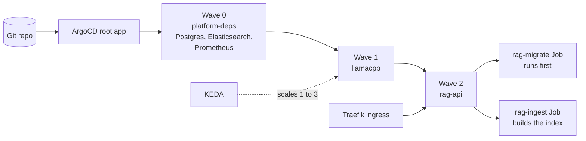

# Kubernetes deployment

## Layout

| Path | What |
|------|------|
| `deploy/helm/platform-deps` | Single-instance PostgreSQL, Elasticsearch and a minimal Prometheus that only scrapes llama.cpp (for KEDA). Dev only: no HA, no backups. Hand-written rather than upstream charts because Bitnami images are no longer free and the official Elasticsearch Helm chart is deprecated (ECK is the replacement, too heavy here). |
| `deploy/helm/llamacpp` | llama-server, model PVC, initContainer that downloads the pinned GGUF and checks its sha256, KEDA ScaledObject, Ingress or Route. |
| `deploy/helm/rag-api` | RAG API, Alembic migrate Job (Helm `pre-install,pre-upgrade` hook, run by ArgoCD as PreSync), one-shot corpus ingest Job, Ingress or Route. |
| `deploy/argocd/root.yaml` | Root Application (app-of-apps). |
| `deploy/argocd/apps` | Chart that renders one Application per chart. Sync waves: 0 platform-deps, 1 llamacpp, 2 rag-api. |
| `infra/kind/cluster.yaml` | Single-node kind cluster, host port 8090 to the Traefik NodePort. |
| `infra/git-server/Dockerfile` | `git daemon` image that serves this repo to ArgoCD. |

Every chart has `values.yaml` (common, SCC-safe), `values-kind.yaml` and `values-openshift.yaml`.

| | kind | OpenShift |
|--|------|-----------|
| Exposure | Ingress, class `traefik`: rag-api at `http://rag-api.localhost:8090`, llamacpp as the host-less catch-all at `http://127.0.0.1:8090` (Windows does not resolve `*.localhost` for every client) | Route, edge TLS, router-generated host |
| UID | fixed `runAsUser: 1000650000`, `runAsGroup: 0` (emulates an OpenShift arbitrary UID; the llama.cpp and postgres images default to root) | none set; restricted-v2 SCC assigns UID and fsGroup |
| Model PVC | ReadWriteOnce (single node, all replicas share it) | ReadWriteMany (replicas may be on different nodes) |
| rag image | `localhost:5001/industrial-llm-platform/rag@sha256:...`: kind-up pushes the image and passes the pushed digest to the rag-api Application as the Helm `image` parameter (the tag `0.1.0` is mutable, so a tag alone would not roll out a rebuild) | `image-registry.openshift-image-registry.svc:5000/llm/rag@sha256:...`: okd-up pushes to the internal registry and passes the digest the same way |

All pods: `runAsNonRoot`, `seccompProfile: RuntimeDefault`, `allowPrivilegeEscalation: false`, all capabilities
dropped, `readOnlyRootFilesystem: true` except Elasticsearch (writes its keystore under `config/` at start).
The `llm` namespace enforces Pod Security `restricted` on kind.

Compose-only: Grafana, Tempo, the OpenTelemetry Collector and the SLO recording and alert rules are not deployed in
kind; the in-cluster Prometheus exists only for the KEDA trigger. Because there is no collector in kind, rag-api
does not export traces there and the `trace_id` in its SSE `session` event is all zeros.

## Deploy order

ArgoCD syncs the apps in waves, so each layer finds what it needs already running:



## Commands

```bash
bash scripts/kind-up.sh       # cluster, registry, git server, KEDA, Traefik, ArgoCD, apps; waits for Synced/Healthy
GIT_SOURCE=worktree bash scripts/kind-up.sh   # opt-in: publish uncommitted work (see below)
bash scripts/keda-demo.sh      # loadgen through the ingress + UTC timeline of KEDA scale up and down
bash scripts/helm-check.sh    # helm lint --strict + kubeconform -strict, kind and openshift values
bash scripts/kind-down.sh     # deletes the cluster, kind-registry, kind-git (compose is untouched)
```

`kind-up.sh` is idempotent, also after a failed run: re-run it to publish new commits (and a rebuilt rag image) to
ArgoCD. The rag image is built from
`git -c core.autocrlf=false archive --format=tar --mtime=1970-01-01T00:00:00Z <published revision>:rag` with
`--provenance=false`, so the same revision gives the same digest here and in CI (`ci/run.sh build`) and nothing rolls; a changed image rolls
rag-api and also recreates the ingest Job (`Force=true,Replace=true`, a Job template is immutable), which deletes
the `corpus` index and builds it again: chat has no index for about 9 minutes and then a complete one (the index is
not swapped in behind an alias). kind sets the current kubectl context to `kind-llm`; the scripts always pass
`--context kind-llm`.

A slow or flaky network only makes it slower: every image the cluster runs is pulled on the host and imported into
the node first (the list is rendered from the installed manifests), downloads are retried, the pinned charts and the
ArgoCD manifest are cached in `.tools/downloads`, readiness waits retry past a Deployment's 600 s progress deadline
instead of giving up (as `helm --wait` and `kubectl rollout status` do), CoreDNS forwards over TCP, and the model
download resumes. The final ArgoCD wait fails only at its deadline (3 hours, `KIND_UP_TIMEOUT`), not early on a
Degraded app. Evidence, including a recovery from a progress-deadline-exceeded KEDA install: `docs/evidence/phase5b-ci.txt`.

Clean runs on the dev machine: 34m25s, 39m05s, 46m28s (Phase 5a), and 28m46s on a290dea with the images already on
the host (model download about 5.5 minutes, ingest about 12 minutes); a re-run with everything in place takes about
a minute. Most of the time is the 1.1 GB model download (network bound) and the corpus ingest Job.

## How ArgoCD reads this repo without a remote

ArgoCD reads no git remote (GitHub is used only by GitHub Actions). `kind-up.sh` keeps a bare repo in `.tools/git/industrial-llm-platform.git` (git-ignored)
and runs `git daemon` in a container named `kind-git` on the kind Docker network, with that directory mounted
read-only. ArgoCD uses `git://kind-git/industrial-llm-platform`, branch `main`.

- Default (`GIT_SOURCE=head`): publishes the committed `HEAD`, so the ArgoCD revision is a real commit of this repo.
- Opt-in (`GIT_SOURCE=worktree`): builds a synthetic commit of the current working tree (tracked and untracked
  files, minus `.gitignore`) through a throwaway index and `git commit-tree`, and publishes that. It is not in this
  repo's history, and it includes untracked files. No branch, ref or index of this repo changes, but the new blobs,
  trees and the commit are written to `.git/objects` and stay there until `git gc` prunes them (after its expiry).
  Phase 5a evidence was recorded this way because the work was not yet committed; after the commit, the expected
  step is `GIT_SOURCE=head bash scripts/kind-up.sh` to record the same state with a real revision.

Limitation: ArgoCD only sees what was published. Edits after the last `kind-up.sh` run are invisible to it until
you re-run the script (it then refreshes the apps). This is a dev stand-in for a real git server, not a GitOps
flow with review; the git daemon has no auth. On kind it is reachable only on the kind Docker network (for OKD see
below: there it listens on the host's loopback).

## OpenShift

Tested on OKD 4.22 (4.22.0-okd-scos.10) via OpenShift Local (crc 2.64.0, preset `okd`, no Red Hat account), single
node; not tested on Red Hat OpenShift. `values-openshift.yaml` deployed unchanged: every pod ran under SCC
`restricted-v2` with the namespace's UID, the RWX model PVC bound on crc's hostpath class, a chat through the
rag-api Route returned a cited answer, and the migrate and ingest Jobs completed. The KEDA ScaledObject was Ready,
but KEDA was not load-tested on OKD. Evidence and what was not tested: `docs/evidence/v3-openshift-okd.txt`.

```bash
bash scripts/okd-up.sh   # crc (20 GB, 6 vCPU), ArgoCD operator, KEDA, rag image, app-of-apps; waits for Synced/Healthy
crc stop
```

One-time admin step: install the crc MSI (it adds you to `crc-users` and `Hyper-V Administrators`) and reboot. Then
run from a normal, non-admin shell. Stop the kind containers first if RAM is short
(`docker stop llm-control-plane kind-registry kind-git`; `docker start` them afterwards). The first deployment was
done step by step with the same commands (with a manual crc daemon restart in between): about 39 minutes from the
root Application to Healthy (image pulls in the VM, model download, ingest), plus crc setup and first boot. Re-runs
of `okd-up.sh` on the running cluster took about 2 minutes. `okd-up.sh` was not run end to end on a fresh machine.

How it differs from kind:
- ArgoCD is the community `argocd-operator` (v0.19.0, ArgoCD v3.4.4) instead of upstream `install.yaml`, whose redis
  pins UID 999. The Application health check goes into the `ArgoCD` CR; the `llm` namespace carries
  `argocd.argoproj.io/managed-by=argocd`.
- KEDA is the same Helm chart (2.21.0); the OKD catalog only has KEDA 2.7.1 (observed, no raw log kept).
- The rag image is pushed with skopeo to the internal registry route, and its digest goes to rag-api as on kind.
- ArgoCD reads branch `okd` of the same bare repo (kind's `main` is untouched), served by a git daemon container on
  `127.0.0.1:9418`, which the VM reaches as `host.crc.testing` (crc `host-network-access`).
- Routes use edge TLS from the router CA: `.tools/okd/ingress-ca.crt` after a run, for `curl --cacert`.

On a multi-node cluster you still need a real ReadWriteMany storage class for the model PVC, and
`vm.max_map_count >= 262144` on the nodes for Elasticsearch (OpenShift sets it; the crc node had 262144). The upstream
postgres and elasticsearch images worked as an arbitrary UID with group 0; a Red Hat supported image would be the
usual choice on OCP.

Security: crc `host-network-access` lets every pod in the VM reach every port on the host's loopback, not only the
git daemon: from the rag-api pod, `host.crc.testing` ports 9418, 5432 (compose Postgres), 9200 (compose
Elasticsearch), 3000, 8080, 9090 and 3100 answered (`docs/evidence/v3-openshift-okd/session2-checks.txt`). Fine for
a dev VM running only this stack; do not run untrusted workloads in it. It stays on because ArgoCD keeps polling
git; closing it after a sync stops GitOps reconciliation (steps in the `okd-up.sh` header). `okd-up.sh` stops if the
option was off while the crc daemon runs (the daemon reads it only at start) and prints the restart steps.
