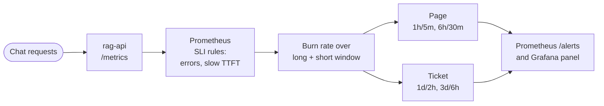

# SLOs

Two SLOs for the RAG chat endpoint (`POST /chat` on `rag-api`). Both use a rolling 30-day window and are
computed by Prometheus from `rag-api` metrics. Rules: `prometheus/rules/recording.yml` (SLIs, error budget)
and `prometheus/rules/alerts.yml` (burn-rate alerts). Unit tests: `prometheus/tests/slo_test.yml` and
`prometheus/tests/slo_windows_test.yml`. Dashboard: Grafana "RAG API and SLOs" (`grafana/dashboards/rag.json`).

These are CPU development targets for one llama.cpp replica (Qwen2.5-1.5B Q4_K_M, 4 threads, 2 slots).
They describe what this setup can hold, not what a GPU deployment should promise. Revisit both after
the Phase 2 GPU numbers exist.

| SLO | Target | Window | Error budget |
|-----|--------|--------|--------------|
| RAG availability | 99% of valid `/chat` requests succeed | 30d | 1% of requests |
| RAG TTFT | 95% of `/chat` requests get the first token within 60 s | 30d | 5% of requests |

## 1. RAG availability

**SLI.** Good events / valid events, where:
- valid = `/chat` requests whose status class is not 4xx (client errors such as a 422 for an empty message
  are the caller's fault and do not spend the budget);
- bad = `/chat` responses in the 5xx class, plus chats that failed after the stream started
  (`rag_chat_errors_total`).

`rag_http_requests_total` labels `status` with the class (`2xx`, `4xx`, `5xx`), not the literal code.

Why both terms: `/chat` is SSE. FastAPI sends the 200 headers before retrieval and generation run, so a
failure in Elasticsearch, the reranker, llama.cpp or Postgres is reported in-band as an `error` event and the
HTTP status stays 200. `rag_chat_errors_total` counts exactly those. One request is never counted in both.

Unhandled route exceptions count as 5xx. The metrics middleware in `rag/app/main.py` records in a `finally`
block with a default status of 500. So an exception that Starlette's `ServerErrorMiddleware` later turns into a
500 is still counted.

```promql
# slo:sli_error:ratio_rate<W>{slo="rag-availability"}, W in 5m 30m 1h 2h 6h 1d 3d 30d
(
  (sum(rate(rag_http_requests_total{job="rag-api",path="/chat",status=~"5.."}[W])) or vector(0))
  + (sum(rate(rag_chat_errors_total{job="rag-api"}[W])) or vector(0))
)
/
sum(rate(rag_http_requests_total{job="rag-api",path="/chat",status!~"4.."}[W]))
```

rag-api pre-creates the `/chat` `2xx`, `4xx` and `5xx` series at 0 on startup (checked on the live `/metrics`),
so the first 5xx after a restart shows as an increase. `or vector(0)` stays as a guard in case a series is
ever missing. The regex matchers (`5..`, `4..`) match both the class labels and literal codes.

**Target 99%.** One replica of everything, no failover, restarts during development. 99% allows about
7 hours of full outage per 30 days at constant traffic. Tighter targets need a second replica first.

**Blind spots.**
- The SLI only sees requests that reach the API. If `rag-api` is down, there are no requests and the ratio is
  empty, not bad. `RagApiDown` (`up{job="rag-api"} == 0` for 2m, severity page) covers that.
- Requests in flight when the rag-api process dies are never counted. `rate()` handles the counter reset itself.

## 2. RAG TTFT (p95)

**SLI.** Fraction of chats whose time to first token is at most 60 s. TTFT is measured in `rag-api` from
the start of the chat (session lookup, retrieval and prompt build included) to the first streamed token. It is
observed in the histogram `rag_stage_duration_seconds{stage="ttft"}`. "95% of requests at or under 60 s"
means the same as "p95 TTFT <= 60 s", but the ratio form is exact from buckets, while `histogram_quantile`
interpolates.

```promql
# slo:sli_error:ratio_rate<W>{slo="rag-ttft"}
1 - (
  sum(rate(rag_stage_duration_seconds_bucket{job="rag-api",stage="ttft",le=~"60|60.0"}[W]))
  /
  sum(rate(rag_stage_duration_seconds_count{job="rag-api",stage="ttft"}[W]))
)
```

`prometheus_client` exposes the bucket as `le="60.0"` and Prometheus v3.15.0 stores it unchanged (checked
with `/api/v1/series`). The matcher also accepts `60` for Prometheus 2.x text-format scrapes.

**Threshold 60 s, target 95%.** The bucket boundaries are 0.05, 0.1, 0.25, 0.5, 1, 2, 5, 10, 20, 30, 60 and
120 s, so the threshold must be one of these. What decides it is llama.cpp's prompt cache: a prompt it has
seen before skips most of the prefill, and the prefill is where CPU TTFT goes.

Eval run 20261008T113955Z (`rag/eval/results/20261008T113955Z/raw.jsonl`, fields `ttft_s` and
`usage.prompt_tokens_details.cached_tokens`, 30 sequential questions, measured client side):
- all 30: median 2.58 s, nearest-rank p95 26.7 s, 26 of 30 at or under 5 s, 29 of 30 at or under 30 s;
- 27 of the 30 prompts had been sent in earlier runs and were served almost entirely from the prompt cache
  (cached_tokens = prompt_tokens - 1). Their TTFT is 0.96 to 13.27 s;
- the 3 new questions (ids 10 to 12) had cached_tokens of 62 to 64, so a cold prefill of 1211 to 1731 prompt
  tokens. They took 21.72, 26.7 and 34.54 s.

Eval run 20261008T095250Z is superseded for its scores, but its prompts were mostly cold (at most 42% of any prompt cached):
median 22.8 s, 23 of 30 (77%) at or under 30 s, 30 of 30 at or under 60 s (max 59.09 s), nearest-rank p95
41.08 s.

Real users send new questions with new retrieved context, so the cold numbers are the ones to plan for.
- 30 s holds for the cached eval (97%) but not for cold traffic: 77% in the earlier run and 2 of 3 in the new
  one. It would miss the 95% target in normal use.
- 60 s has held for every cold request measured so far (33 of 33).

So 60 s stays, as a CPU-dev target. A 40 or 45 s bucket would be tighter and still above the cold p95 of about
41 s; see "Open items".

**Scope.** Only chats that produced a first token are in the denominator. Chats that fail before the first
token are counted by the availability SLO instead, so a failure is never counted twice.

## Burn-rate alerts

How an alert is raised:



Multi-window, multi-burn-rate alerts from the Google SRE workbook (chapter "Alerting on SLOs"). Burn rate is
error ratio / (1 - target); burn rate 1 spends the budget in exactly 30 days. Each alert fires only if both its
long window (is the burn significant?) and its short window (is it still happening?) are over the threshold.

| Alert | Severity | Long / short window | Burn rate | Availability threshold | TTFT threshold | Budget spent when it fires |
|-------|----------|---------------------|-----------|------------------------|----------------|----------------------------|
| `*ErrorBudgetBurnFast` | page | 1h / 5m | 14.4 | 14.4% | 72% | 2% in 1h |
| | page | 6h / 30m | 6 | 6% | 30% | 5% in 6h |
| `*ErrorBudgetBurnSlow` | ticket | 1d / 2h | 3 | 3% | 15% | 10% in 1d |
| | ticket | 3d / 6h | 1 | 1% | 5% | 10% in 3d |

`*` is `RagAvailability` or `RagTTFT`. Each SLO has two alerts (page and ticket), and each alert ORs its two
window pairs, as in the workbook. There is no `for:` clause because the short window already filters blips.

**Low traffic.** On a dev box with a handful of chats per hour, one failed chat can push the 5m and 1h ratios
over 14.4%. That is correct by the definition (the budget is per request), but it makes pages noisy at low
volume. If that becomes a problem, add a minimum request count to the page rules (the workbook's "low
traffic" section) rather than loosening the target.

**Delivery.** Prometheus evaluates the alerts. They show at `/alerts`, at `/api/v1/alerts` and in the
"Firing alerts" panel. No Alertmanager runs, so nothing is sent anywhere. Add one when there is a receiver.

## Error budget panel

`slo:error_budget:remaining{slo}` = 1 - (30d error ratio / (1 - target)). 1 means untouched, 0 means spent and
a negative value means the SLO is missed. It is shown in the "Error budget remaining (30d)" panel next to the
30d SLI and the 1h and 6h burn rates. The budget rule is in the same rule group as its 30d ratio, so it uses
that evaluation's ratio, not the previous one.

Retention: Prometheus runs with `--storage.tsdb.retention.time=31d` and a `prometheus` volume. Data survives
container recreation, and the 30d windows are complete after 30 days of uptime. Until then they cover only the
data collected since 2026-10-08 11:43:55Z, when the volume was added.

## How it is tested

`promtool test rules` with synthetic series, in two files.

`prometheus/tests/slo_windows_test.yml` tests the recording rules end to end. It feeds raw counters (2m samples
over 4400m) with a stepped error rate, so every window sees a different ratio. It asserts exact values (to
1e-4; the arithmetic is in the file) of all 8 `slo:sli_error:ratio_rate<W>` windows and of
`slo:error_budget:remaining` for three cases:
- availability with 5xx errors and 4xx noise;
- availability with in-stream errors only (`rag_chat_errors_total`, no 5xx);
- TTFT.

The 3d and 30d windows give different values because the series runs longer than 3 days and its first 82
minutes contain errors that only the 30d window sees. So this file pins the range of every window, both terms
of the availability SLI and both budgets.

`prometheus/tests/slo_test.yml` tests alert behaviour, in two parts.

Scenarios from raw counters (1m samples):
- 20% 5xx pages and tickets, and 4xx traffic does not dilute the ratio;
- 20% in-stream errors page;
- the page clears after errors stop: at 70m the 1h/5m pair is already off but the 6h/30m pair still pages,
  and at 100m both are off;
- 4% errors for a day tickets but does not page (each pair's boolean is checked);
- 0.5% errors for a day does nothing;
- a 2-minute total outage after 6 healthy hours does not alert, although the 5m ratio is 40%;
- TTFT 50% slow pages, 10% slow tickets only, 3% slow does nothing and leaves 40% of the budget;
- `RagApiDown` fires after 2 minutes.

Alert logic one window pair at a time, for both SLOs, with the ratio series fed in directly:
- only that pair at 1.1x its threshold fires the right alert and not the other one;
- the long window at 0.95x, or the short window at 0.95x, fires nothing.

This pins every window name in `alerts.yml`, and every threshold to within about 5 to 10%. A smaller change,
for example 14.4x to 15x, is not caught (mutant o3 in the table).

Mutation check: 17 deliberate rule bugs (reviewer mutants m1 to m9 and n1 to n6, plus o1 and o2) each make
`promtool test rules` fail. They cover wrong thresholds, swapped windows, wrong ranges, a dropped SLI term, a
wrong budget and 4xx counted as errors. The table is in the evidence file.

Live check: `docs/evidence/phase4-observability.txt`.

## Not covered yet

- **GPU SLOs:** none. The GPU dashboard (`grafana/dashboards/gpu.json`, uid `gpu`) is a replay of the nvidia-smi
  samples (every 500 ms, not DCGM: on Kaggle DCGM's basic fields work but its profiling fields need root, run v3a) captured during the Phase 2 Kaggle run of 2026-10-09
  05:54 to 06:33Z, backfilled into Prometheus by `gpu-replay/backfill.sh`. It is not live data, so no SLO or
  alert uses it.
- **RAG quality** (recall@5, faithfulness) comes from an offline eval and is not an SLI. The dashboard shows
  the eval numbers as text.

## Open items

- A 40 or 45 s bucket in `rag_stage_duration_seconds` (`STAGE_LATENCY` buckets in `rag/app/main.py`) would allow
  a tighter TTFT threshold than 60 s. After that change, update the threshold here, in `recording.yml` and in
  both test files.
- Measure TTFT on unique, cold prompts at the target load: more than 33 samples, ideally from the benchmark load
  generator. That would put the 60 s threshold on firmer ground.
